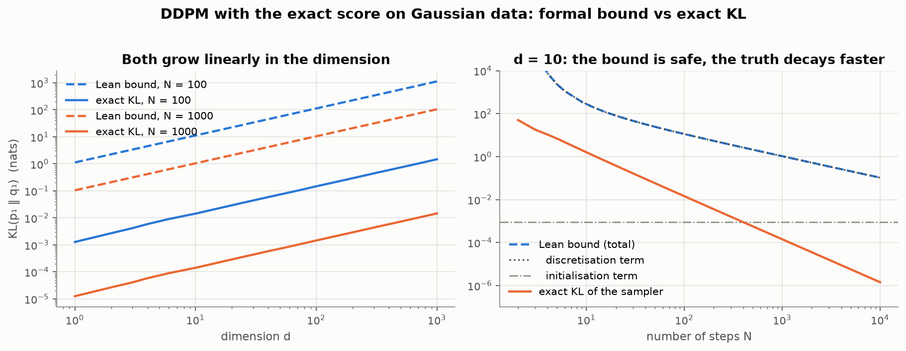
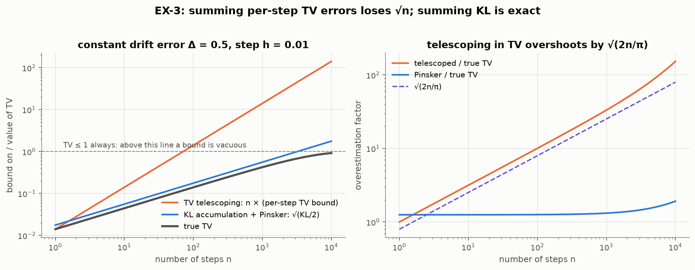

# FormalizeSampling

[](https://github.com/hendrydong/FormalizeSampling/actions/workflows/lean.yml)

**Machine-checked versions of published convergence theorems for sampling algorithms, in Lean 4
and Mathlib, and the framework they are built from.**

The library proves in Lean versions of the end-to-end guarantees of several published analyses of
sampling algorithms. Each Lean statement names its sampler, hypotheses and constants; where they
differ from the paper, the difference is listed under
[Published theorems in Lean](#published-theorems-in-lean).

- **Diffusion models.** Take any data law on $`\mathbb{R}^d`$ with finite second moment and any
  measurable learned score. The KL divergence from the early-stopped data law to the output of the
  DDPM sampler is at most an initialisation term, plus a discretisation term linear in $`d`$, plus
  the score error averaged under the true marginals. This is a version of Theorem 2 of
  [Benton–De Bortoli–Doucet–Deligiannidis (2024)](https://arxiv.org/abs/2308.03686), for the
  posterior-mean step with the same reverse variance. With reverse variance $`\beta`$, on grids that
  are geometric up to a time set by the step ratio and arbitrary afterwards, the discretisation
  term depends on neither the number of steps nor the horizon: a version of Theorem 3.1 of
  [Koike (2026)](https://arxiv.org/abs/2605.18040).
- **Proximal sampler.** For every $`\alpha`$-strongly log-concave target $`\pi`$, every step
  $`\eta \gt 0`$ and every start $`\rho_0`$ with finite KL,
  $`\mathrm{KL}(\rho_k \Vert \pi) \le \mathrm{KL}(\rho_0 \Vert \pi)/(1+\alpha\eta)^{2k}`$. This is
  the KL part of Theorem 3 of [Chen–Chewi–Salim–Wibisono (2022)](https://arxiv.org/abs/2202.06386),
  with the log-Sobolev inequality it assumes proved in Lean; the same holds, with a smaller
  $`\alpha`$ from the Holley–Stroock lemma, for bounded perturbations of Gaussian targets, which
  need not be log-concave. For every log-concave target $`\pi \propto e^{-f}`$ ($`f`$ convex and
  finite) there is a $`1/k`$ rate from any coupling of the start with the target. This is a version
  of their Theorem 2, proved by the shifted-composition argument of
  [Altschuler–Chewi (2023)](https://arxiv.org/abs/2311.14520).
- **The inequalities and equations behind them.** The log-Sobolev inequality that the Bakry–Émery
  criterion gives for strongly log-concave measures on $`\mathbb{R}^d`$, proved through the
  Prékopa–Leindler inequality; the Holley–Stroock perturbation lemma; the Gaussian log-Sobolev
  inequality; and existence and uniqueness for the weak Fokker–Planck equation with Lipschitz
  drifts, proved without SDE theory. Each is stated in the form the samplers use: for instance,
  the log-Sobolev inequalities hold for differentiable, bounded test functions with bounded
  gradients and a positive lower bound.

Every proof is checked by the Lean kernel, with no `sorry` and no axioms beyond `propext`,
`Classical.choice` and `Quot.sound`. Comparing each statement with its paper is a documented
reading, not a kernel guarantee; [`docs/literature.md`](docs/literature.md) records it step by
step.

These theorems are assembled from one framework. It relates the law a sampling algorithm produces
to its target and tracks where the gap comes from: discretisation, score estimation, kernel
approximation, the initial law, deterministic versus stochastic dynamics. It covers Langevin and
Fokker–Planck dynamics, the proximal sampler, Metropolis–Hastings, Gaussian-increment chains
(ULA / Euler–Maruyama), deterministic transport (probability flow, preconditioned functional
gradient flow, deterministic steps, the SVGD objective) and DDPM/DDIM-type diffusion models, with
both guarantees and counterexamples. The same statements keep apart distinctions the literature
has observed, such as uniform score accuracy versus total variation for deterministic samplers, or
path versus output KL; see [Distinctions](#distinctions-the-statements-keep-visible).

Every core statement names the divergence and its direction, the law under which an error is
averaged, the quantifier and the object certified. About 94,000 lines of Lean, 4,000 documented
theorems and 54 core results: 43 Verified, 8 formal counterexamples, 3 Conditional.

- Status, hypotheses and Lean names of every core result:
  [`docs/theorem_registry.md`](docs/theorem_registry.md)
- Results by area: [`docs/results.md`](docs/results.md); published analyses step by step:
  [`docs/literature.md`](docs/literature.md)
- Statement audit: [`docs/statement_audit.md`](docs/statement_audit.md); every documented
  theorem: [`docs/declaration_index.md`](docs/declaration_index.md); vocabulary:
  [`docs/glossary.md`](docs/glossary.md)
- To use the framework in your own analysis, start with
  [Using FormalizeSampling](#using-formalizesampling).

## Published theorems in Lean

Each row is a published theorem of which Lean proves a version. "What Lean proves" paraphrases the
headline Lean statements; their docstrings and the [registry](docs/theorem_registry.md) give the
exact hypotheses. IDs such as DF-1 or PX-6, in the last column and throughout this README, refer
to rows of the registry, one row per core result; [Coverage at a glance](#coverage-at-a-glance)
groups them by area. "Differences from the paper" follows the step-by-step reading in
[`docs/literature.md`](docs/literature.md), including the parts that are not formalised. Lemmas
and related statements from further works are in the [literature map](#literature-map).

Notation for the diffusion rows: the data law $`\mu`$ is noised by an Ornstein–Uhlenbeck process,
observed at times $`0 = t_0 \lt t_1 \lt \cdots \lt t_N = T`$, with
$`\alpha_k = e^{-(t_k - t_{k-1})}`$, $`\beta_k = 1 - \alpha_k^2`$, heat times
$`u_k = e^{2t_k} - 1`$, marginals $`p_k`$ and second moment $`M = \mathbb{E}_\mu \Vert X \Vert^2`$;
$`p_1`$ is the data noised up to the early-stopping time $`t_1`$. The DDPM sampler starts from
$`\mathcal{N}(0, I)`$ and steps
$`y \mapsto \mathcal{N}((y + \beta_k s_k(y))/\alpha_k, \sigma_k^2 I)`$ for $`k = N, \ldots, 2`$,
with a learned score $`s_k`$; its output is $`q_1`$. A deterministic sampler (probability-flow ODE /
DDIM) instead steps $`y \mapsto A_k(y) + b_k s_k(y)`$, with no noise, for maps $`A_k`$ and score
coefficients $`b_k \in \mathbb{R}`$; the exponential-integrator step of the probability-flow ODE
has $`A_k(y) = y/\alpha_k`$ and $`b_k = 1/\alpha_k - 1`$. TV between two laws $`P, Q`$ is
$`\sup_A \lvert P(A) - Q(A) \rvert`$.

| Work and theorem | What Lean proves | Differences from the paper | Status and Lean names |
|---|---|---|---|
| [Bao–Li–Zhu–Zhang (2022)](https://arxiv.org/abs/2201.06503), Analytic-DPM: Theorem 1 and Corollary 2 | For data with finite second moment, every step $`k \ge 2`$ and every reverse variance $`v \gt 0`$, the averaged one-step error $`\int \mathrm{KL}(R_k(y) \Vert \mathcal{N}(m^*_k(y), vI)) \, dp_k(y)`$ against the exact reverse kernel $`R_k`$ equals an explicit entropy and posterior-variance expression. For $`d \ge 1`$ it is minimised at the Analytic-DPM variance $`v^* = C/d`$ ($`C`$ the averaged posterior variance), with excess $`(d/2)(\log(v/v^*) + v^*/v - 1)`$. Among isotropic Gaussians of a fixed variance the mean of $`R_k(y)`$ is KL-optimal, and it is the posterior mean given by Tweedie's formula | Per step, for the DDPM forward process and isotropic Gaussian reverse kernels; not an end-to-end bound. Not formalised: the two-sided bounds on the optimal variance (Theorem 2, Corollary 3; only $`C \gt 0`$ is stated), the Monte Carlo estimate of the score norm, the trajectory optimisation (Theorem 3) | DF-4 Verified (variance), DF-1 Verified (mean): `DiffusionDiscretization.lintegral_klDiv_revKernel_var_eq`, `DiffusionDiscretization.varStep_eq_opt`, `Diffusion.klDiv_pi_gaussianReal_mean_le`, `Diffusion.postMean_ae_eq_tweedie` |
| [Benton–De Bortoli–Doucet–Deligiannidis (2024)](https://arxiv.org/abs/2308.03686), Theorem 2 and Corollary 1 | Data: any probability law on $`\mathbb{R}^d`$ with finite second moment (no density). Grid: $`u_{k+1} - u_k \le \kappa u_k`$. Sampler: DDPM with $`\sigma_k^2 = \beta_k/\alpha_k^2`$ and any measurable score. Then $`\mathrm{KL}(p_1 \Vert q_1) \le \mathrm{KL}(p_N \Vert \mathcal{N}(0, I)) + (\kappa d/2)(1 + \log(u_N/u_1)) + \sum_{k=2}^N (\beta_k/2) \, \mathbb{E}_{p_k} \Vert s_k - \nabla \log p_k \Vert^2`$. The initialisation term is at most $`e^{-2(t_N - t_1)}`$ times an explicit constant in $`d`$, $`\beta_1`$ and $`M`$; TV follows by Pinsker; geometric grids give a closed form. Step count: for every $`\varepsilon \gt 0`$ an explicit geometric grid with $`N \le 2(d + 1)L(L + 2)/\varepsilon + 2L + 2`$ steps, where $`L`$ depends on $`d`$, $`M`$, $`\varepsilon`$ and $`u_1`$ only through a logarithm, gives $`\mathrm{KL}(p_1 \Vert q_1) \le \varepsilon`$ plus the score-error term; with the exact score a grid of the same form gives $`\mathrm{TV}(p_1, q_1) \le \varepsilon`$ | Sampler: the posterior-mean (Tweedie) step; the paper's exponential integrator has the same reverse variance $`e^{2h} - 1`$ and a different score coefficient. The grid condition is stated in heat time. Proof: a discrete-time chain rule, an exact per-step entropy identity of the heat flow, de Bruijn's identity, monotonicity of Fisher information and $`J(u) \le d/u`$. Of App. H only the tensorisation step is formalised | DF-1 Verified: `DiffusionDiscretization.klDiv_output_le_ddpm_grid`, `DiffusionDiscretization.klDiv_output_le_ddpm_grid_explicit`, `DiffusionDiscretization.tvSup_output_le_ddpm_grid`, `DiffusionDiscretization.klDiv_output_le_geomGrid_steps`, `DiffusionDiscretization.exists_klDiv_output_le` |
| [Koike (2026)](https://arxiv.org/abs/2605.18040), Theorem 3.1 with Corollary 3.1 | The same data and scores, DDPM with $`\sigma_k^2 = \beta_k`$, and a grid with $`u_{k+1} - u_k \le \kappa u_k`$ for $`k \lt m`$ and $`1 \le \kappa u_m \le 1 + \kappa`$, arbitrary after $`m`$. Then $`\mathrm{KL}(p_1 \Vert q_1) \le \mathrm{KL}(p_N \Vert \mathcal{N}(0, I)) + (\kappa/2)\bigl(d(2 + \log((1+\kappa)/(\kappa u_1))) + 2\max(M - d, 0)\bigr) + \sum_{k=2}^N (\beta_k/(2\alpha_k^2)) \, \mathbb{E}_{p_k} \Vert s_k - \nabla \log p_k \Vert^2`$: the discretisation term depends on neither $`N`$ nor $`T`$. Explicit initialisation term and TV bound as in the row above | The same sampler: Koike's Euler–Maruyama scheme for the Föllmer process is this DDPM step (the identification is not formalised). The grid condition and the constants differ. Proof: an exact per-step formula and the trace Cramér–Rao bound. The TV bound follows by Pinsker; Corollary 3.2 (the step count for a TV target) is not stated as a theorem. Not formalised: the Föllmer process, Theorem 3.2 (no early stopping) and the intrinsic-dimension bounds | DF-4 Verified: `DiffusionDiscretization.klDiv_output_le_betaVar`, `DiffusionDiscretization.klDiv_output_le_betaVar_explicit`, `DiffusionDiscretization.tvSup_output_le_betaVar` |
| [Chen–Chewi–Salim–Wibisono (2022)](https://arxiv.org/abs/2202.06386), Theorem 3, KL part; the KL case of [Mitra–Wibisono (2025)](https://arxiv.org/abs/2410.10699), Theorem 2 | Proximal sampler with step $`\eta \gt 0`$: forward step $`\mathcal{N}(x, \eta I)`$, then the exact restricted Gaussian oracle. If $`\alpha \gt 0`$ and $`f - \alpha \Vert x \Vert^2/2`$ is convex, then for $`\pi \propto e^{-f}`$ and every start with finite KL, $`\mathrm{KL}(\rho_k \Vert \pi) \le \mathrm{KL}(\rho_0 \Vert \pi)/(1+\alpha\eta)^{2k}`$ and $`\mathrm{TV}(\rho_k, \pi) \le \sqrt{\mathrm{KL}(\rho_0 \Vert \pi)/(2(1+\alpha\eta)^{2k})}`$, on `Fin d → ℝ` and on `EuclideanSpace ℝ (Fin d)`. The same for $`\pi \propto e^{-\alpha \Vert x \Vert^2/2 - W}`$ with $`W`$ measurable and $`a \le W \le b`$, with $`\alpha e^{-(b-a)}`$ in place of $`\alpha`$. For a general target ($`f`$ measurable) the same rates hold given its log-Sobolev inequality with constant $`1/\alpha`$ and a Gaussian upper envelope $`\pi \le C \cdot \mathcal{N}(0, vI)`$. For the target $`\mathcal{N}(0, \alpha^{-1} I)`$ and $`d \ge 1`$, no per-step factor below $`(1+\alpha\eta)^{-2}`$ holds for every start | Theorem 3 assumes a log-Sobolev inequality; for the two classes above Lean proves it (Bakry–Émery through Prékopa–Leindler; Gross and Holley–Stroock). For general targets the Gaussian upper envelope is an additional hypothesis. Only the KL part: the Rényi bound and Theorems 4–5 are not formalised. The backward step is analysed through explicit posterior kernels. The factor is attained from starts $`\mathcal{N}(m, \alpha^{-1} I)`$; the covariance recursion of §4.4 is not formalised | PX-6, PX-4 Verified; PX-2 Conditional (general target); PX-3, EX-3 Verified (Gaussian targets): `ProximalStronglyLogConcaveGeneralPi.toReal_klDiv_iteratePi_le_sq_of_stronglyLogConcave`, `EuclideanTransfer.toReal_klDiv_iterateEuclid_le_sq_of_stronglyLogConcave`, `ProximalSharpPerturbedPi.toReal_klDiv_iteratePi_le_sq_perturbed_of_ne_top`, `ProximalGeneralLSIPi.toReal_klDiv_iteratePi_le_sq_general`, `ProximalSharpPi.not_exists_rate_lt_pi` |
| [Chen–Chewi–Salim–Wibisono (2022)](https://arxiv.org/abs/2202.06386), Theorem 2 | If $`f`$ is convex and finite on `Fin d → ℝ` with $`\int e^{-f} \lt \infty`$, $`\pi \propto e^{-f}`$ and $`\eta \gt 0`$, then for every start $`\rho_0`$, every coupling $`\gamma_0`$ of $`(\rho_0, \pi)`$ and every $`k \ge 0`$, $`\mathrm{KL}(\rho_{k+1} \Vert \pi) \le \int \Vert x - y \Vert^2 \, d\gamma_0 / (2(k+1)\eta)`$, including starts with infinite KL | The bound holds for each coupling; the infimum over couplings ($`W_2`$) is not formed. The constant is the one given by the shifted-composition argument of Altschuler–Chewi (2023), also stated for the proximal sampler by [Pedrotti (2026, Cor. 3.5)](https://arxiv.org/abs/2601.13259). Proof: shifted composition, with a contractive coupling of the oracle built from Euler–Maruyama chains of Langevin dynamics, Fokker–Planck uniqueness, smooth approximation and lower semicontinuity of KL; the argument of App. A.3 is not formalised | PX-5 Verified: `ProximalLogConcaveRateConvexPi.klDiv_iteratePi_le_div_of_convexOn` |
| [Altschuler–Chewi (2023)](https://arxiv.org/abs/2311.14520), Theorem 3.2, for KL with $`L = 1`$ | Let $`K`$ be a kernel with a weak contractive coupling, $`P = K \circ \mathcal{N}_\eta`$ and $`\Lambda, \Gamma`$ probability laws on pairs, with first marginal $`\Lambda_1`$ of $`\Lambda`$ and second marginal $`\Gamma_2`$ of $`\Gamma`$. Then $`\mathrm{KL}(P^{k+1}\Lambda_1 \Vert P^{k+1}\Gamma_2) \le \mathrm{KL}(\Lambda \Vert \Gamma) + \int \Vert x - y \Vert^2 \, d\Lambda/(2(k+1)\eta)`$. The oracle of every finite convex potential has such a coupling | KL only, $`L = 1`$, and kernels of the form Gaussian convolution followed by $`K`$; the shifted chain rule (Theorem 3.1) is proved for this Gaussian-shift construction only, with no infimum over couplings. Not formalised: Rényi divergences, $`L \ne 1`$, the Harnack inequalities | PX-5 Verified: `RGOCouplingWeak.klDiv_iterate_le_shifted_of_weak`, `ProximalLogConcaveRateConvexPi.hasWeakCoupling_rgoKernelPi_of_convexOn` |
| [Gross (1975)](https://doi.org/10.2307/2373688), the Gaussian log-Sobolev inequality | $`\mathcal{N}(0, tI)`$ satisfies the functional log-Sobolev inequality with constant $`t`$, for every $`t \gt 0`$. KL form: $`\mathrm{KL}(\rho \Vert \mathcal{N}(0, vI)) \le (v/2) \, I(\rho \Vert \mathcal{N}(0, vI))`$ for $`\rho`$ with a positive differentiable density, finite second moment and finite relative Fisher information, and along the heat flow from every law with finite second moment | The functional form is stated for differentiable, bounded test functions with bounded gradient and a positive lower bound, and extended to positive $`C^1`$ functions with integrability. Proof: the KL form, from the de Bruijn identity and the decay of Fisher information along the heat flow. Not formalised: the equivalence with hypercontractivity | KL-5, KL-6 Verified: `GaussianFunctionalLSIPi.functionalLSIPi_gaussian`, `GaussianLSIZeroPi.klDiv_le_fisher0` |
| [Bakry–Émery (1985)](https://www.numdam.org/item/SPS_1985__19__177_0/), the log-Sobolev inequality given by their curvature criterion (Corollaire 2 with Proposition 4) | If $`\alpha \gt 0`$ and $`f - \alpha \Vert x \Vert^2/2`$ is convex on `Fin d → ℝ`, then $`\pi \propto e^{-f}`$ satisfies $`\mathrm{Ent}_\pi(g^2) \le (2/\alpha) \int \Vert \nabla g \Vert^2 \, d\pi`$ for every test function $`g`$. Also the Prékopa–Leindler inequality for measurable functions on `Fin d → ℝ` with values in $`[0, \infty]`$ | Only the conclusion, for Gibbs measures on $`\mathbb{R}^d`$, proved by the Bobkov–Ledoux route through Prékopa–Leindler. Not formalised: the $`\Gamma_2`$ criterion and the semigroup argument, the equivalence with hypercontractivity. Test functions as in the row above | KL-6 Verified: `BakryEmeryGeneralPi.functionalLSIPi_targetPi_of_convexOn`, `PrekopaLeindler.prekopa_leindler` |
| [Holley–Stroock (1987)](https://doi.org/10.1007/BF01011161), the bounded-perturbation lemma | If $`\mu`$ satisfies the functional log-Sobolev inequality with constant $`C \ge 0`$ and $`W`$ is measurable with $`a \le W \le b`$, then $`e^{-W}\mu/Z`$ satisfies it with constant $`C e^{b-a}`$, on $`\mathbb{R}`$ and on `Fin d → ℝ` | Pointwise bounds on $`W`$. Not formalised: the log-Sobolev inequalities for stochastic Ising models, the paper's main subject | KL-6 Verified: `GaussianFunctionalLSIPi.functionalLSIPi_tilt`, `HolleyStroock.functionalLSI_tilt` |
| [DiPerna–Lions (1989)](https://doi.org/10.1007/BF01393835), Theorem II.2 | For an autonomous velocity $`v \in W^{1,1}_{\mathrm{loc}}`$ with essentially bounded divergence, bounded or of linear growth, uniformly bounded probability-density solutions of the weak continuity equation with the same initial density coincide a.e. for every $`t \ge 0`$. The same for probability densities bounded in $`L^p`$ ($`1 \lt p \lt \infty`$) when $`v \in W^{1,q}_{\mathrm{loc}}`$ ($`1/p + 1/q = 1`$) has bounded divergence and linear growth | Autonomous velocities and probability-density solutions only. Not formalised: time-dependent velocities, signed solutions, the $`L^1`$ theory, existence (Proposition II.1), stability (Theorem II.4) and the flows of §III | Proved with no named hypothesis (filed under FL-5, whose general form is Conditional): `NoiseScore.ae_eq_of_weakContinuityDensity_diPernaLions_linearGrowth`, `NoiseScore.ae_eq_of_weakContinuityDensity_diPernaLions_Lp` |
| [Bogachev–Krylov–Röckner–Shaposhnikov (2015)](https://doi.org/10.1090/surv/207), Ch. 9: uniqueness of probability solutions of the Fokker–Planck–Kolmogorov equation | For $`D \gt 0`$ and a drift jointly continuous in $`(t, x)`$ and Lipschitz in $`x`$ uniformly on each $`[0, T]`$, probability solutions of the weak Fokker–Planck equation with the same initial law coincide for $`t \ge 0`$, with no moment, density or tightness assumption, and a solution exists. For autonomous drifts every solution is the weak limit of the dyadic Euler–Maruyama laws; Langevin dynamics with Lipschitz $`\nabla U`$ is well-posed | The globally Lipschitz case of the theorem for drifts with $`\langle b(t, x), x \rangle \le C + C \Vert x \Vert^2`$, with a constant scalar diffusion $`D`$. Not formalised: dissipative drifts that are not globally Lipschitz, degenerate and matrix diffusions, a rate for the Euler–Maruyama convergence. Proof: an approximate Kolmogorov duality, with no SDE theory | FL-6 Verified: `FokkerPlanckUniqueness.eq_of_weakFokkerPlanck_lipschitz`, `FokkerPlanckUniqueness.existsUnique_weakFokkerPlanck_lipschitz_continuousTime`, `FokkerPlanckUniqueness.tendsto_emCurveP_of_weakFokkerPlanck_lipschitz` |
| PFG: [Dong–Wang–Lin–Zhang (2023)](https://arxiv.org/abs/2211.13954), Proposition 1 and Theorem 1 | Proposition 1: over any class of admissible fields, the PFG objective and $`\tfrac12 \int \Vert f - H^{-1} \nabla \log(\pi/\rho) \Vert_H^2 \, d\rho`$ have the same minimisers. Theorem 1: take a flow of positive densities solving the continuity equation whose velocity minimises the objective over a class closed under negation, with [A3] (one $`\varepsilon \lt 1`$) and [A4] (the target's log-Sobolev inequality with constant $`\lambda`$, used in the form it takes along the flow) as hypotheses and $`\lambda_{\max}(H) \le m`$. Then $`\frac{d}{dt}\mathrm{KL} \le -\frac{1-\varepsilon}{2} I_{H^{-1}}`$ and $`\mathrm{KL}(t) \le e^{-(1-\varepsilon)\lambda t/m} \, \mathrm{KL}(0)`$ | $`H`$ constant and positive definite, or time-dependent and state-independent. The flow, its regularity and the minimiser are hypotheses. Not formalised: the estimated preconditioner, the RKHS case, the strict inequality of Proposition 2, App. A.6 beyond dimension one | SE-1 Verified (Proposition 1); FL-4 Conditional on [A3], [A4] and the flow hypotheses (Theorem 1): `SteinObjective.isMinOn_steinObjective_iff`, `KLDissipation.klDecay_of_steinMinimiser` |




The rows share their proofs, which is what the framework is for: the log-concave proximal rate
couples oracles through Euler–Maruyama chains of Langevin dynamics, identified by Fokker–Planck
existence and uniqueness, and the DDPM bounds use the de Bruijn identity and the decay of Fisher
information from the development of the Gaussian log-Sobolev inequality.

## Distinctions the statements keep visible

Because each statement names the divergence, its direction and the averaging law, the following
distinctions stay explicit:

- **KL direction fixes the averaging law.** Per-step errors are averaged under the chain in the
  first KL argument (KL-2): GI-1 and GI-2 average under the algorithm's laws, DF-1 and DF-5 put
  the data first and average score errors under the true marginals, and KR-1 names the averaging
  law in TV.
- **One Pinsker step, not telescoped TV.** The KL chain rule followed by one Pinsker step (GI-1)
  has no $`\sqrt{n}`$ loss; on an example where its bound is attained, summed one-step TV bounds
  overshoot the true TV by a factor of at least $`\sqrt{2n/\pi}`$ (EX-3).
- **Contraction along the chain, not uniform contraction.** Contraction along a chain's laws does
  not give a uniform TV contraction (CE-07); PX-2, PX-4 and PX-6 contract KL from every start with
  finite KL, and the stable size of a deterministic step depends on the current law (DT-1, CE-08).
- **One-time marginals, not path laws.** Equal one-time marginals do not give equal two-time laws
  (CE-01, EX-1); for DDPM on standard Gaussian data with the exact score the output KL is
  $`\Theta(h^2)`$ while the path KL is of order at least $`h`$ (DF-5, DF-8).
- **Which score accuracy suffices.** $`L^2(p_k)`$ accuracy suffices for DDPM (DF-1); uniform
  accuracy does not give TV accuracy for deterministic samplers (DF-3, DF-7) but controls a
  coupling distance to the exact-score output (DF-9); with a small Lipschitz constant as well, it
  still fails over a long horizon (DF-10).

Three worked examples follow. Each phenomenon was observed before; each example opens with that
work and then says what Lean proves.

### Uniform score accuracy versus total variation for deterministic samplers

For DDPM, score accuracy in $`L^2(p_k)`$ is enough, given fine enough steps and a long enough run;
for deterministic samplers (probability-flow ODE / DDIM) uniform score accuracy is not. This is
known: [Li–Wei–Chen–Chi (2023, §3.2)](https://arxiv.org/abs/2306.09251) perturb the last step of a
deterministic sampler by a rounding error, small in $`L^2`$, that puts the output at
total-variation distance 1 from Gaussian data, and
[Li–Di–Gu (2024, Thm 3.1)](https://arxiv.org/abs/2410.14237) give a smooth score within
$`\varepsilon`$ of the true score everywhere for which the continuous-time probability-flow ODE
stays a fixed total-variation distance away from Gaussian data, however small $`\varepsilon`$ is.
Lean proves the following version. For every data law with finite second moment, there are
learned scores within $`\varepsilon`$ of the true score everywhere for which the deterministic
sampler ends at total-variation distance $`\ge 1 - \eta`$ from $`p_1`$, while DDPM with the same
score and reverse variance $`\sigma_k^2 = \beta_k/\alpha_k^2`$ keeps its end-to-end KL guarantee.
The error can even be an analytic function of the exact update, placed at the last step, at the
price of a large Lipschitz constant. For this error the failure is one of concentration, not
displacement: under an explicit coupling the deterministic output stays within
$`\lvert b_2 \rvert \cdot \varepsilon`$ of the exact-score deterministic output, so uniform score
accuracy controls the transport distance to the exact-score output but not the total-variation
distance to $`p_1`$. Li–Wei–Chen–Chi suggest a Wasserstein metric for their example.

An error present throughout the run can also move mass where the exact flow is unstable, as
between two modes. That injected noise contracts the divergence between two runs while a
deterministic flow keeps it fixed is proved by
[Nie et al. (2024, Thms 3.1–3.2)](https://arxiv.org/abs/2311.01410), and
[Ashiq et al. (2026)](https://arxiv.org/abs/2605.06831) analyse the region between two modes of a
Gaussian mixture: late in sampling, deterministic trajectories near the midpoint stay there while
DDPM's noise lets them escape, and a score error with the right directional structure can make the
equilibrium near the midpoint instantaneously stable. The first figure is a one-dimensional
numerical instance: the data has two modes, the score error is below 0.07, has Lipschitz constant
0.7 and is nonzero only near the midpoint, and the deterministic sampler puts 23% of its output
between the modes, where the data has 3%; DDPM with the same score does not. For standard Gaussian
data the forward process is stationary and the exact probability-flow velocity vanishes, so the
flow does not correct a persistent error; this is the setting of
[Li–Di–Gu (2024, Thm 3.1)](https://arxiv.org/abs/2410.14237). Lean proves a version for discrete
steps (DF-10): an error that is at most $`\varepsilon`$ in sup norm and $`\varepsilon`$-Lipschitz,
acting over a horizon of at most $`A/\varepsilon`$ ($`A`$ independent of $`\varepsilon`$), makes
the deterministic sampler collapse while DDPM with the same score stays within total-variation
distance $`\eta`$ of $`p_1`$. For standard Gaussian data the deterministic output is at
total-variation distance $`\ge 1 - \eta`$. For two atoms $`(\delta_{-a} + \delta_a)/2`$ the error is
switched on at high noise only, where the forward law is close to $`\mathcal{N}(0, 1)`$ and the
exact step close to the identity, and the deterministic output puts mass $`\ge 1 - \eta`$ on a slab
around the midpoint where $`p_1`$ puts mass $`\le \eta`$. This two-atom construction differs from
the figure: the data are atoms, the error is a clamp acting on a wide window rather than near the
midpoint only, it acts at high noise only, and the output collapses onto the midpoint rather than
gaining a third mode.
*DF-3, DF-7, DF-9, DF-10 (Verified). The figures are numerical; the construction in the first is
not formalised; DF-10 uses its own.*


### Path KL versus output KL

Many guarantees for DDPM-type samplers compare the sampler with the true reverse process: they bound
the sum of per-step errors against the exact reverse kernels, or the KL divergence between the path
law of the reversed forward process and that of the sampler. That this route stops at order $`1/N`$
is known: [Benton et al. (2024, §4)](https://arxiv.org/abs/2308.03686) note that the path KL is of
the order of the step size in the worst case, for instance for point-mass data, citing
[Chen et al. (2023, Thm 7)](https://arxiv.org/abs/2209.11215), who prove such a lower bound for the
critically damped Langevin sampler on standard Gaussian data with the exact score, and
[Li–Yan (2024, §3.1)](https://arxiv.org/abs/2409.18959) make the same point for this sampler. For
the DDPM chain with reverse variance $`\sigma^2 = \beta/\alpha^2`$ and data with $`M \le d`$ (e.g.
data in $`[-1, 1]^d`$), Lean proves that both are bounded below by order $`d/N`$ on a uniform grid
over a fixed interval $`0 \lt t_1 \lt T`$: the per-step sum for the exact score, the path KL for any
score (DF-4, DF-5). For every data law with finite second moment the per-step sum is bounded below
by order $`1/N`$ per unit of log-time, minus a term that depends on $`M`$ and does not shrink as
$`N`$ grows (DF-6). The output itself can converge faster. For standard Gaussian data the
exact-score output KL on the same grids is $`\Theta(d/N^2)`$, with matching-order upper and lower
bounds, while the path KL stays of order at least $`d/N`$ (DF-8); a bound of order $`1/N^2`$ on the
output cannot follow by upper-bounding this full true-path KL and applying data processing alone.
[Jiao–Zhou–Li (2025, Thm 2)](https://arxiv.org/abs/2510.27562) prove an output lower bound of the
same order for Gaussian data on their schedule, and reach output rates of order $`1/N^2`$ (up to
logarithmic factors) for general data by applying the chain rule along an auxiliary reverse chain
that has the same marginals as the forward process but different transitions, a device used earlier
by [Li–Cai (2024)](https://arxiv.org/abs/2410.23285) for an accelerated sampler.
*DF-4, DF-5, DF-6, DF-8 (Verified).*


### One Pinsker step versus telescoped TV, and an attained proximal rate

Diffusion-model analyses sum KL errors step by step
([Chen–Lee–Lu, 2023](https://arxiv.org/abs/2211.01916)) or along the path
([Chen et al., 2023](https://arxiv.org/abs/2209.11215)) and apply Pinsker once. Lean proves this
route for Gaussian-increment chains $`x \mapsto \mathcal{N}(x + h_k g_k(x), 2h_k I)`$ (ULA,
Euler–Maruyama) with exact drifts $`g_k`$, estimated drifts $`\hat{g}_k`$ and algorithm laws
$`\nu_k`$:
$`\mathrm{KL}(\nu_n \Vert \mu_n) \le \mathrm{KL}(\nu_0 \Vert \mu_0) + \sum_k (h_k/4) \int \Vert g_k - \hat{g}_k \Vert^2 \, d\nu_k`$,
where $`\mu_k`$ are the exact chain's laws, followed by one Pinsker step (GI-1). For a constant
drift error $`\Delta`$ and constant step $`h`$ from a common point mass the KL bound holds with
equality, while the telescoped TV bound (the sum of the one-step bounds
$`\sqrt{h} \, \Vert \Delta \Vert / (2\sqrt{\pi})`$) exceeds the true TV by a factor of at least
$`\sqrt{2n/\pi}`$ (EX-3). Exact computations also show where a rate is attained. That the
proximal factor $`(1+\alpha\eta)^{-2}`$ is sharp on Gaussian targets is observed by
Chen–Chewi–Salim–Wibisono (2022, §4.4; see also
[Mitra–Wibisono, 2025, App. G.2](https://arxiv.org/abs/2410.10699)). Lean proves that for
$`\pi = \mathcal{N}(0, \alpha^{-1} I)`$ and starts $`\mathcal{N}(m, \alpha^{-1} I)`$ one step
divides the KL by exactly $`(1+\alpha\eta)^2`$, so that no smaller factor holds for every start
(PX-3, EX-3).
*GI-1, EX-3, PX-3 (Verified).*



## How the library is organised

Sampling algorithms in the literature look heterogeneous, but their analyses reuse a few moves, and
the theorems above are assembled from them. A guarantee typically bounds the divergence between
output and target by the contracted initial error plus the sum of per-step errors. Each
discretisation error is computed by differentiating along a curve and each score error from a
representation of the score; comparisons of laws link the pieces, identifying the law pins down the
exact chain or curve, and exact computations show that a step is tight or necessary.

| Move | What it provides | Main modules | Registry IDs |
|---|---|---|---|
| Comparison of laws | Pinsker and the two TV normalisations, KL chain rule and data processing, tensorisation, Gaussian KL, lower semicontinuity, extension from warm starts to every start with finite KL | [`Foundations/Pinsker`](FormalizeSampling/Foundations/Pinsker.lean), [`Foundations/KLChainRule`](FormalizeSampling/Foundations/KLChainRule.lean), [`Foundations/KLWarmApprox`](FormalizeSampling/Foundations/KLWarmApprox.lean), [`Foundations/GaussianKL`](FormalizeSampling/Foundations/GaussianKL.lean) | KL-1 … KL-4 |
| Error accumulation | compare the algorithm's chain with an exact chain step by step: initial mismatch plus summed discretisation and oracle errors, by TV telescoping, by the KL chain rule and one Pinsker step, or by couplings | [`Kernels/ErrorPropagationKL`](FormalizeSampling/Kernels/ErrorPropagationKL.lean), [`Kernels/ErrorDecomposition`](FormalizeSampling/Kernels/ErrorDecomposition.lean), [`Samplers/GaussianIncrementPi`](FormalizeSampling/Samplers/GaussianIncrementPi.lean), [`Samplers/DiffusionMain`](FormalizeSampling/Samplers/DiffusionMain.lean), [`Samplers/DiffusionPath`](FormalizeSampling/Samplers/DiffusionPath.lean) | KR-1, GI-1, GI-2, DF-1, DF-2, DF-4, DF-5, DF-9, DF-10 |
| Contraction | the exact kernel or flow brings every admissible law closer to the target: log-Sobolev inequalities (Gaussian, Gross, tensorisation, Holley–Stroock, Bakry–Émery), LSI plus heat flow gives a KL contraction, couplings and shifted composition | [`Foundations/BakryEmeryGeneralPi`](FormalizeSampling/Foundations/BakryEmeryGeneralPi.lean), [`Foundations/HolleyStroock`](FormalizeSampling/Foundations/HolleyStroock.lean), [`Samplers/ProximalGeneralLSIPi`](FormalizeSampling/Samplers/ProximalGeneralLSIPi.lean), [`Samplers/RGOCouplingWeak`](FormalizeSampling/Samplers/RGOCouplingWeak.lean), [`Flow/OULangevinDecayPi`](FormalizeSampling/Flow/OULangevinDecayPi.lean) | KL-5, KL-6, PX-2 … PX-6, CE-07 |
| Differentiation along a curve | $`\frac{d}{dt} \mathrm{KL}`$ along a continuity equation, Fisher dissipation, approximate velocities, Grönwall with a source, de Bruijn along the forward and backward heat flows, one-step descent for $`\mathrm{id} + \eta v`$ | [`Identities/KLTransportVariation`](FormalizeSampling/Identities/KLTransportVariation.lean), [`Flow/KLDissipation`](FormalizeSampling/Flow/KLDissipation.lean), [`Flow/ApproximateVelocity`](FormalizeSampling/Flow/ApproximateVelocity.lean), [`Flow/DeterministicStepPi`](FormalizeSampling/Flow/DeterministicStepPi.lean), [`Foundations/HeatFlowDeBruijnPi`](FormalizeSampling/Foundations/HeatFlowDeBruijnPi.lean) | FL-1 … FL-4, DT-1, CE-08 |
| Identification of the law | a kernel, curve or particle system has the law the analysis assumes: Bayes reverse kernels (the RGO among them), Metropolis–Hastings invariance, weak Fokker–Planck and continuity equations (existence, uniqueness, DiPerna–Lions) without SDE theory, equal one-time marginals | [`Kernels/ReverseKernel`](FormalizeSampling/Kernels/ReverseKernel.lean), [`Samplers/ProximalPi`](FormalizeSampling/Samplers/ProximalPi.lean), [`Samplers/MetropolisHastings`](FormalizeSampling/Samplers/MetropolisHastings.lean), [`Flow/FokkerPlanckUniqueness`](FormalizeSampling/Flow/FokkerPlanckUniqueness.lean), [`Flow/NoiseScoreEquivalence`](FormalizeSampling/Flow/NoiseScoreEquivalence.lean) | KR-2, PX-1, MH-1, ID-3, ID-4, FL-5, FL-6, PT-1, CE-01 |
| Score representation and estimation | the score as a posterior mean (Tweedie, OU posterior) or as the minimiser of a Stein/Hyvärinen objective (feature classes, SVGD); Monte Carlo and inner-sampler errors; what a score cannot be | [`Identities/Tweedie`](FormalizeSampling/Identities/Tweedie.lean), [`Identities/OUPosteriorScore`](FormalizeSampling/Identities/OUPosteriorScore.lean), [`ScoreEstimation/SteinObjective`](FormalizeSampling/ScoreEstimation/SteinObjective.lean), [`ScoreEstimation/FeatureClass`](FormalizeSampling/ScoreEstimation/FeatureClass.lean), [`ScoreEstimation/MonteCarlo`](FormalizeSampling/ScoreEstimation/MonteCarlo.lean) | ID-1, ID-2, SE-1 … SE-4, CE-02, CE-04, CE-05, CE-06 |
| Exact computation | Gaussian closed forms and explicit constructions that attain a bound, bound it from below, or separate two samplers | [`Examples/GaussianIncrementTight`](FormalizeSampling/Examples/GaussianIncrementTight.lean), [`Samplers/ProximalSharpPi`](FormalizeSampling/Samplers/ProximalSharpPi.lean), [`Samplers/DiffusionGaussianOutput`](FormalizeSampling/Samplers/DiffusionGaussianOutput.lean), [`Samplers/DiffusionODESeparation`](FormalizeSampling/Samplers/DiffusionODESeparation.lean), [`Counterexamples/ULADiscretization`](FormalizeSampling/Counterexamples/ULADiscretization.lean) | EX-1, EX-2, EX-3, DF-3, DF-6, DF-7, DF-8, CE-03 |

Each registry ID appears once, under its primary move; most results use several moves, and the
[literature map](docs/literature.md) decomposes published analyses into them step by step. The three
Conditional rows sit at unproved inputs to the moves: PX-2 and FL-4 assume a log-Sobolev inequality
(the input of contraction), and FL-5 assumes a weak Fokker–Planck equation and uniqueness for a
continuity equation (identification of the law). Lean namespaces do not always follow file names
(for example `Foundations/KLChainRule` declares `KL.*`); the [declaration
index](docs/declaration_index.md) gives the file of every theorem.

## Literature map

Each row says which steps of a published analysis are formalised here and with which status.

| Work | Algorithm | What is formalised here | Status |
|---|---|---|---|
| [Ho–Jain–Abbeel (2020)](https://arxiv.org/abs/2006.11239); [Bao et al. (2022)](https://arxiv.org/abs/2201.06503) | DDPM; Analytic-DPM reverse variance | forward chain and sampler, per-step KL as a mean error, Tweedie mean; a version of Bao et al. Thm 1 and Cor. 2 per step, with exact excess; training, decoder, variance bounds and trajectory search not formalised | DF-1, DF-4, DF-5, DF-8 Verified |
| [Chen et al. (2023)](https://arxiv.org/abs/2209.11215); [Chen–Lee–Lu (2023)](https://arxiv.org/abs/2211.01916) | exponential-integrator and Euler–Maruyama schemes for the reverse SDE | a discrete-time chain rule for the path KL, the score/discretisation split as an equality, initialisation and Pinsker steps; Girsanov, the Lipschitz and Hessian discretisation lemmas, $`W_2`$ and CLD not formalised | DF-1, DF-5, GI-1, KL-1 Verified |
| [Benton–De Bortoli–Doucet–Deligiannidis (2024)](https://arxiv.org/abs/2308.03686) | exponential integrator with early stopping | a version of Thm 2 for the Tweedie-mean sampler, proved by heat-flow entropy identities, and of Cor. 1 with an explicit step count; path-KL lower bounds related to its §4; stochastic localisation not formalised | DF-1, DF-5, DF-6 Verified |
| [Conforti–Durmus–Gentiloni Silveri (2023)](https://arxiv.org/abs/2308.12240); [Koike (2026)](https://arxiv.org/abs/2605.18040) | samplers with step variance $`\beta`$ | a version of Koike Thm 3.1, whose discretisation term is independent of $`T`$ and $`N`$, by an exact per-step formula and the trace Cramér–Rao bound; a related statement for the step variance $`\beta`$ of Conforti–Durmus–Gentiloni Silveri Cor. 1; Fisher decay along the heat flow; the Föllmer process, Itô calculus and kinetic OU not formalised | DF-4, DF-5, KL-5 Verified |
| [Li–Yan (2024)](https://arxiv.org/abs/2409.18959); [Jiao–Zhou–Li (2025)](https://arxiv.org/abs/2510.27562); [Li–Cai (2024)](https://arxiv.org/abs/2410.23285); [Sun–Poor–Zhang (2026)](https://arxiv.org/abs/2601.13602) | DDPM: output KL versus path KL | path-KL lower bounds of order $`dh`$ for every mean map; Gaussian-data output KL of order $`dh^2`$; a per-step lower bound for every data law; auxiliary-chain upper bounds, schedules and Gaussian extremality not formalised | DF-5, DF-6, DF-8 Verified |
| [Li–Wei–Chen–Chi (2023)](https://arxiv.org/abs/2306.09251); [Li–Di–Gu (2024)](https://arxiv.org/abs/2410.14237) | deterministic (probability-flow, DDIM) samplers | a version of the §3.2 example, for every data law with finite second moment; a discrete-time analogue of Li–Di–Gu Thm 3.1 with an analytic one-step error, and its stationary-Gaussian setting with a clamp error acting over a horizon of order $`1/\varepsilon`$; the Wasserstein remark as a coupling bound; the TV convergence bounds not formalised | DF-3, DF-7, DF-9, DF-10 Verified |
| [Nie et al. (2024)](https://arxiv.org/abs/2311.01410); [Ashiq et al. (2026)](https://arxiv.org/abs/2605.06831) | SDE versus ODE runs; dynamics between two modes | special cases of Nie et al.: de Bruijn for two heat-flow runs (Thm 3.1 with zero drift), KL invariance under bijections (component of Thm 3.2); the non-strict data-processing step behind Thm 3.3 (its strict inequality and the Cycle-SDE kernels not formalised); Ashiq et al. not formalised | KL-2, KL-4 Verified; the heat-flow de Bruijn identity holds under an explicit regularity hypothesis (used in KL-5 and PX-2) |
| [Pidstrigach (2022)](https://arxiv.org/abs/2206.01018); [Li–Chen–Li (2024)](https://arxiv.org/abs/2401.04856); [Gu et al. (2023)](https://arxiv.org/abs/2310.02664) | reverse diffusion with the exact empirical score | memorisation for the discretised DDPM sampler with early stopping, related to Pidstrigach Cor. 1 and Li–Chen–Li Thm 4.3 (discrete time, parameters chosen existentially); the empirical score through Tweedie; continuous-time support results and Girsanov not formalised | DF-2, DF-1, SE-3 Verified |
| [Lee–Shen–Tian (2021)](https://arxiv.org/abs/2010.03106) | proximal sampler with the restricted Gaussian oracle (RGO) | the RGO as Bayes reverse kernel and invariance (Lemma 1); Lemma 4's one-step bound for every coupling; the case $`\mu = 0`$ of Lemma 2; RGO implementations not formalised | PX-1, PX-5 Verified; the coupling bound is proved with no named hypothesis (filed under PX-2, whose general form is Conditional) |
| [Chen–Chewi–Salim–Wibisono (2022)](https://arxiv.org/abs/2202.06386); [Mitra–Wibisono (2025)](https://arxiv.org/abs/2410.10699) | proximal sampler, analysed along forward and backward heat flows | the KL part of Thm 3 of Chen–Chewi–Salim–Wibisono and the KL case of Mitra–Wibisono Thm 2; a version of Chen–Chewi–Salim–Wibisono Thm 2 by shifted composition; sharpness on Gaussian targets; Rényi, $`\chi^2`$ and other $`\Phi`$-divergences not formalised | PX-2 Conditional on the LSI; PX-3 … PX-6, EX-3 Verified |
| [Altschuler–Chewi (2023)](https://arxiv.org/abs/2311.14520); [Pedrotti (2026)](https://arxiv.org/abs/2601.13259) | shifted composition | a version of Altschuler–Chewi Thm 3.2 for KL with $`L = 1`$; the special case $`\alpha = 0`$, $`L = 0`$, second law $`\pi`$ of Pedrotti Cor. 3.5; Rényi, Harnack and defective-curvature results not formalised | PX-5 Verified |
| [Gross (1975)](https://doi.org/10.2307/2373688); [Holley–Stroock (1987)](https://doi.org/10.1007/BF01011161); [Bakry–Émery (1985)](https://www.numdam.org/item/SPS_1985__19__177_0/) | log-Sobolev inequalities for the target | the Gaussian log-Sobolev inequality, in functional and KL–Fisher form, proved along the heat flow; the bounded-perturbation lemma; strong convexity gives $`\mathrm{LSI}(1/\alpha)`$, by monotone transport in 1D and Prékopa–Leindler on `Fin d → ℝ`; the equivalence with hypercontractivity and the $`\Gamma_2`$ semigroup argument not formalised | KL-5, KL-6 Verified; used for PX-2, PX-4, PX-6 |
| [Bogachev–Krylov–Röckner–Shaposhnikov (2015)](https://doi.org/10.1090/surv/207); [DiPerna–Lions (1989)](https://doi.org/10.1007/BF01393835) | weak Fokker–Planck and continuity equations | the Lipschitz case of Fokker–Planck uniqueness (Ch. 9), with existence, without SDE theory; a version of DiPerna–Lions Thm II.2 for autonomous Sobolev velocities and probability densities; dissipative non-Lipschitz drifts and time-dependent velocities not formalised | FL-6 Verified; the DiPerna–Lions results are proved with no named hypothesis (filed under FL-5, whose general form is Conditional) |
| [Wibisono (2018)](https://arxiv.org/abs/1802.08089) | ULA; Langevin dynamics as a KL gradient flow; the forward method | the special case $`\mathcal{N}(0, 1)`$ of Example 2; the Example 4 recursion, with no fixed step a KL descent for all laws; KL decay along OU; SLA and the $`W_2`$ lemmas not formalised | CE-03 Counterexample: for the target $`\mathcal{N}(0, 1)`$, ULA with a step $`h \gt 0`$ does not leave it invariant; CE-08 Counterexample: no fixed step makes the ideal-velocity step a KL descent for all laws; the OU decay is proved with no named hypothesis (filed under FL-4, whose general form is Conditional) |
| SVGD: [Liu–Wang (2016)](https://arxiv.org/abs/1608.04471); PFG: [Dong–Wang–Lin–Zhang (2023)](https://arxiv.org/abs/2211.13954) | deterministic transport by a regularised functional gradient; particle updates | PFG Prop. 1, the KL dissipation identity, Thm 1 with its constants ([A3], [A4] as hypotheses), App. A.6 in 1D; SVGD with finite feature kernels (Liu–Wang Eqs. (6), (8)) as a case of PFG; PFG Prop. 2 and RKHS theory not formalised | SE-1, SE-2, FL-1 … FL-3, DT-1, PT-1, EX-2 Verified; FL-4 Conditional |
| rdMC: [Huang–Dong–Hao–Ma–Zhang (2024)](https://arxiv.org/abs/2307.02037); RS-DMC: [Huang–Zou–Dong–Ma–Zhang (2024)](https://arxiv.org/abs/2401.06325) | reverse diffusion with Monte Carlo posterior-mean scores from an inner sampler | the OU posterior score (rdMC Lemma 1, RS-DMC Lemma 2.1); Monte Carlo score error and inner-sampler bias, propagated by the KL chain rule; a discrete-time KL split of the output; inner ULA and the recursive estimator not formalised | SE-3, SE-4, GI-2, DF-1, DF-5 Verified |
| SPS: [Huang–Zou–Dong–Ma–Zhang (2024)](https://arxiv.org/abs/2405.16734); RTK: [Huang–Zou–Dong–Zhang–Ma–Zhang (2024)](https://arxiv.org/abs/2405.16387) | outer chain of exact Bayes kernels (reverse transition kernel; restricted Gaussian oracle) sampled by inner MCMC | reverse kernels and invariance; per-step inner KL errors summed by the chain rule, then one Pinsker step (RTK Lemma 3.2, SPS Lemma B.5); the exact proximal rate under an LSI; invariance of MALA; mixing of the inner MALA, ULD and SGLD not formalised | KR-2, PX-1, KL-1, KL-2, MH-1 Verified; PX-2 Conditional |

Step-by-step decomposition of each work into these moves:
[`docs/literature.md`](docs/literature.md).

## What "Verified" means

- **Proof.** Every proof is checked by the Lean kernel. The library contains no `sorry` and no
  axioms beyond `propext`, `Classical.choice` and `Quot.sound`; `scripts/AxiomAudit.lean`
  checks every declaration and fails on any other axiom.
- **Hypotheses.** A *Verified* result has only satisfiable regularity or modelling
  hypotheses. When a theorem relies on unproved mathematics (a log-Sobolev inequality, PDE
  uniqueness for a general drift), that ingredient is a named `Prop` in its statement and the
  result is marked *Conditional*.
- **Non-vacuity.** For every registry row, a module in `FormalizeSampling/Audit/` applies
  theorems of the row, or library corollaries whose proofs apply them, to explicit instances
  and discharges every hypothesis inside Lean, so no row holds only because its assumptions are
  contradictory. The guarantee is per row, not per declaration: some cited declarations are
  exercised only through the theorems that use them, and a few only on stationary instances.
- **Encoding.** Statements are checked for encoding pitfalls, such as a real-valued
  `(klDiv …).toReal` hiding an infinite divergence, or an error averaged under the wrong law.
- **Fidelity.** Each statement is compared with the literature and documented with its scope.
  This last step is a human reading, not a kernel guarantee.

Details: [`docs/statement_audit.md`](docs/statement_audit.md).

## Coverage at a glance

<!-- BEGIN GENERATED: coverage -->

| Area | Registry rows | Status |
|---|---|---|
| Diffusion models (DDPM/DDIM, memorisation, variance, path vs output) | DF-1 … DF-10 | 10 Verified |
| Proximal sampler | PX-1 … PX-6 | 5 Verified, 1 Conditional |
| KL toolkit and log-Sobolev inequalities | KL-1 … KL-6 | 6 Verified |
| Flows, Fokker–Planck, continuity equation | FL-1 … FL-6, DT-1 | 5 Verified, 2 Conditional |
| Gaussian-increment chains (ULA / Euler–Maruyama) | GI-1, GI-2 | 2 Verified |
| Identities, score estimation, kernels, MH, particles | ID-1 … ID-4, SE-1 … SE-4, KR-1, KR-2, MH-1, PT-1 | 12 Verified |
| Exact examples (tightness) | EX-1 … EX-3 | 3 Verified |
| Counterexamples | CE-01 … CE-08 | 8 Counterexample |

<!-- END GENERATED: coverage -->

Open directions are listed in [`docs/results.md`](docs/results.md).

## Using FormalizeSampling

To use the framework in your own analysis:

- **Analyse your own algorithm:** import [Core](FormalizeSampling/Core.lean) or individual modules
  for divergence bounds, flows, score identities and kernel error propagation.
- **Change a drift estimator:**
  [random score oracles](FormalizeSampling/Samplers/RandomScoreOracleKernel.lean) propagate
  conditional Monte Carlo bias and variance to output error (GI-2).
- **Approximate an inner sampler:**
  [inner-to-outer error bounds](FormalizeSampling/Samplers/RandomScoreOracleInner.lean) connect
  inner KL or coupling guarantees to outer-chain error, under explicit moment assumptions.

To depend on the library from another Lake project, add it to that project's `lakefile.toml`,
pinned to a commit:

```toml
[[require]]
name = "formalize-sampling"
git = "https://github.com/hendrydong/FormalizeSampling"
rev = "<commit hash>"
```

or, in a `lakefile.lean`,

```lean
require «formalize-sampling» from git
  "https://github.com/hendrydong/FormalizeSampling" @ "<commit hash>"
```

The project must use Lean `v4.35.0` (`leanprover/lean4:v4.35.0` in its `lean-toolchain`). The
library brings Mathlib `v4.35.0`; a project that also requires Mathlib directly must pin the
same version (`rev = "v4.35.0"`). Then run

```bash
lake update formalize-sampling   # record the library and Mathlib in lake-manifest.json
lake exe cache get               # download prebuilt Mathlib
lake build                       # the first build compiles the imported FormalizeSampling modules
```

`import FormalizeSampling.Core` gives the sampler-independent core (`Foundations`, `Identities`,
`Kernels`, `Flow`, `ScoreEstimation`), `import FormalizeSampling` everything, and single modules
such as `FormalizeSampling.Kernels.ErrorPropagationKL` can be imported on their own. The library
is written in the Lean module system, so both ordinary Lean files and modules (`module`, then
`public import FormalizeSampling.Core`) can import it. Every documented theorem is listed by
fully qualified name, with the opening of its docstring and its source line, in
[`docs/declaration_index.md`](docs/declaration_index.md).

Total variation is `FormalizeSampling.TotalVariation.tvSup`,
$`\sup_A \lvert \mu(A) - \nu(A) \rvert`$ over measurable sets $`A`$, at most $`1`$ for probability
measures. Mathlib's `MeasureTheory.tvDist` is the $`L^1`$ distance, twice `tvSup` for probability
measures (`TotalVariation.measureTheory_tvDist_eq_two_mul`; Pinsker in that normalisation is
`Pinsker.measureTheory_tvDist_le_sqrt_two_mul_klDiv`); the names do not clash when both
namespaces are open. Results on `Fin d → ℝ` transfer to Mathlib's `EuclideanSpace ℝ (Fin d)`
through `FormalizeSampling.Foundations.Euclidean`, which is part of the core (see
[Layout](#layout)).

For example, on any measurable space:

```lean
import FormalizeSampling.Core

open MeasureTheory ProbabilityTheory InformationTheory FormalizeSampling TotalVariation

variable {α : Type*} [MeasurableSpace α]

-- Pinsker, with `tvSup μ ν = sup_A |μ(A) - ν(A)|`; Mathlib's `tvDist` is `2 * tvSup`
example {μ ν : Measure α} [IsProbabilityMeasure μ] [IsProbabilityMeasure ν] (h : klDiv μ ν ≠ ⊤) :
    tvSup μ ν ≤ √((klDiv μ ν).toReal / 2) ∧ tvDist μ ν = 2 * tvSup μ ν :=
  ⟨Pinsker.tvSup_le_sqrt_klDiv h, measureTheory_tvDist_eq_two_mul μ ν⟩

-- Two Markov chains from the same start, with kernels `c`-close in KL at every state,
-- stay within `n √(c / 2)` in total variation after `n` steps
example {κ η : ℕ → Kernel α α} [∀ n, IsMarkovKernel (κ n)] [∀ n, IsMarkovKernel (η n)]
    {μ ν : ℕ → Measure α} [IsProbabilityMeasure (μ 0)] (h0 : ν 0 = μ 0)
    (hμ : ∀ n, μ (n + 1) = κ n ∘ₘ μ n) (hν : ∀ n, ν (n + 1) = η n ∘ₘ ν n) {c : ℝ}
    (h : ∀ n x, klDiv (κ n x) (η n x) ≤ ENNReal.ofReal c) (n : ℕ) :
    tvSup (μ n) (ν n) ≤ n * √(c / 2) := by
  have : IsProbabilityMeasure (ν 0) := h0 ▸ inferInstance
  simpa [h0, tvSup_self] using
    ErrorPropagation.tvSup_chain_le_sum_sqrt_klDiv hμ hν (c := fun _ => c) h n
```

On a countably generated state space (including `ℝ` and `Fin d → ℝ`), the following
version accumulates KL before applying Pinsker once. With a common initial law and a
per-step budget `c`, it gives `√(n * c / 2)`. Notice the KL direction and averaging law:
the error is `KL(approximate kernel ‖ exact kernel)`, averaged under the approximate chain.

```lean
import FormalizeSampling.Kernels.ErrorPropagationKL

open MeasureTheory ProbabilityTheory InformationTheory FormalizeSampling TotalVariation

variable {α : Type*} [MeasurableSpace α]
  [MeasurableSpace.CountableOrCountablyGenerated α α]

example {κ η : ℕ → Kernel α α} [∀ n, IsMarkovKernel (κ n)] [∀ n, IsMarkovKernel (η n)]
    {μ ν : ℕ → Measure α} [IsProbabilityMeasure (μ 0)] (h0 : ν 0 = μ 0)
    (hμ : ∀ n, μ (n + 1) = κ n ∘ₘ μ n) (hν : ∀ n, ν (n + 1) = η n ∘ₘ ν n)
    {c : ℝ} (hc : 0 ≤ c)
    (h : ∀ n, ∫⁻ x, klDiv (η n x) (κ n x) ∂(ν n) ≤ ENNReal.ofReal c) (n : ℕ) :
    tvSup (ν n) (μ n) ≤ √((n : ℝ) * c / 2) := by
  have : IsProbabilityMeasure (ν 0) := h0 ▸ inferInstance
  have hKL0 : klDiv (ν 0) (μ 0) ≠ ⊤ := by simp [h0]
  simpa [h0] using ErrorPropagation.tvSup_chain_le_sqrt_klDiv_add_sum
    hμ hν hKL0 (c := fun _ => c) (fun _ => hc) h n
```

A published theorem is applied the same way. The next example, the KL rate of the proximal
sampler for strongly log-concave targets (PX-6), needs the full `import FormalizeSampling`, since
`FormalizeSampling.Core` does not include the samplers. Its target `targetPi`, kernel
`proxKernelPi` and potential `gaussPotentialPi` are in the namespaces `ProximalPi` and
`ProximalSharpPi`.

```lean
import FormalizeSampling

open MeasureTheory ProbabilityTheory InformationTheory FormalizeSampling ProximalPi ProximalSharpPi

-- PX-6: if `f - α|x|²/2` is convex (`gaussPotentialPi α x = α ∑ᵢ xᵢ² / 2`), the proximal
-- sampler with step `η` contracts the KL to `targetPi f ∝ e^{-f}` by `(1 + α η)²` per step
example {d : ℕ} {f : (Fin d → ℝ) → ℝ} {α η : ℝ} (hα : 0 < α) (hη : 0 < η)
    (hf : ConvexOn ℝ Set.univ fun x => f x - gaussPotentialPi α x)
    (ρ : ℕ → Measure (Fin d → ℝ)) [IsProbabilityMeasure (ρ 0)]
    (hρ : ∀ k, ρ (k + 1) = proxKernelPi f η ∘ₘ ρ k) (h0 : klDiv (ρ 0) (targetPi f) ≠ ⊤) (k : ℕ) :
    (klDiv (ρ k) (targetPi f)).toReal
      ≤ (klDiv (ρ 0) (targetPi f)).toReal / (1 + α * η) ^ (2 * k) :=
  (ProximalStronglyLogConcaveGeneralPi.toReal_klDiv_iteratePi_le_sq_of_stronglyLogConcave
    hα hη hf ρ hρ h0 k).2.2
```

## Layout

<!-- BEGIN GENERATED: layout -->

| Directory | Contents |
|---|---|
| `FormalizeSampling.lean`, `FormalizeSampling/Core.lean` | Entry points: the first imports the whole library, the second the sampler-independent core (`Foundations`, `Identities`, `Kernels`, `Flow`, `ScoreEstimation`) |
| `FormalizeSampling/Foundations/` | Vector calculus and scores, total variation, KL tools, Gaussian KL formulas, Gibbs measures, heat kernels, de Bruijn identity and Gaussian log-Sobolev inequality along the heat flow, log-Sobolev inequalities, Bakry–Émery, Prékopa–Leindler, weak derivatives, the bridge to Mathlib's `EuclideanSpace ℝ (Fin d)` |
| `FormalizeSampling/Identities/` | Gaussian and density Stein identities, Tweedie's formula and posterior scores, weak generators, score propagation, first variation of KL under transport |
| `FormalizeSampling/Kernels/` | TV error propagation (per-step errors in TV or KL) and decomposition for inexact kernels, reverse (Bayes) kernels, Gaussian and OU kernels, finite products of kernels |
| `FormalizeSampling/Flow/` | Continuity and Fokker–Planck equations (existence, uniqueness), reverse-time rewriting, KL dissipation and decay, OU flows, deterministic steps |
| `FormalizeSampling/ScoreEstimation/` | Stein/Hyvärinen objective, feature classes, Monte Carlo posterior means |
| `FormalizeSampling/Samplers/` | Gaussian-increment chains and random score oracles, MH/MALA, proximal sampler (heat-flow and backward analysis; also on `EuclideanSpace ℝ (Fin d)`), diffusion models (DDPM/DDIM), particles |
| `FormalizeSampling/Examples/` | Closed-form Gaussian instances and tightness examples |
| `FormalizeSampling/Counterexamples/` | Refutations of tempting general claims |
| `FormalizeSampling/Audit/` | Statement audit: Lean witnesses on non-degenerate instances for every registry row |

The directories are layered: a module imports only modules of its own or a lower layer, in the order
`Foundations` < `Identities`, `Kernels` < `Flow`, `ScoreEstimation` < `Samplers` < `Examples`,
`Counterexamples` < `Audit` (checked by `scripts/check_contracts.py`). `FormalizeSampling/Core.lean`
imports every module of `Foundations`, `Identities`, `Kernels`, `Flow` and `ScoreEstimation` (the
three lowest layers), the sampler-independent core; `FormalizeSampling.lean` imports everything.
Every file is a Lean module, so both modules (`public import FormalizeSampling.Core`) and ordinary
Lean files can import the library.

<!-- END GENERATED: layout -->

Files whose names end in `Pi` work on `Fin d → ℝ`. Most have a one-dimensional counterpart
without the suffix (for example `Samplers/Proximal.lean` for `Samplers/ProximalPi.lean`), which
is a separate proof on `ℝ`, not the `Pi` form at $`d = 1`$. The suffix is not exhaustive: many files
without it, such as the flow and diffusion developments, are also stated on `Fin d → ℝ`.

`Foundations/Euclidean.lean` identifies `Fin d → ℝ` with Mathlib's `EuclideanSpace ℝ (Fin d)`
(Lebesgue measure, distances, inner products, Gaussians, Gibbs measures, KL, `tvSup`, gradients
and Laplacians correspond), and `Samplers/EuclideanTransfer.lean` restates Bakry–Émery, the
invariance of the target under the proximal sampler (PX-1) and the strongly log-concave
proximal-sampler rate (PX-6) there.

The rest of the repository:

| Directory | Contents |
|---|---|
| `scripts/` | Axiom audit (`AxiomAudit.lean`) and contract checker (`check_contracts.py`) |
| `experiments/`, `tests/` | Exact-arithmetic and numerical illustrations (never proofs) and their tests |
| `showcase/` | Experiments in numpy and matplotlib with figures for the headline results ([`showcase/README.md`](showcase/README.md)); illustrations, not proofs, not run in CI; most assert numerically the Lean inequality they illustrate |
| `docs/` | Results by area, literature map, theorem registry, declaration index, glossary, statement audit |

## Building and checking

The project pins Lean `v4.35.0` and Mathlib `v4.35.0` (`lean-toolchain`,
`lake-manifest.json`).

```bash
export PATH=$HOME/.elan/bin:$PATH
lake exe cache get                      # download prebuilt Mathlib
lake build                              # build the whole library
lake build FormalizeSampling.Core       # or only the sampler-independent core
lake env lean scripts/AxiomAudit.lean   # axiom audit; resolve names in registry, index and docs
python3 scripts/check_contracts.py      # modules, docstrings, trust boundary, registry and docs
python3 -m unittest discover -s tests -v
uvx ruff@0.16.10 check scripts experiments tests showcase  # ruff pinned in requirements-dev.txt
uvx ruff@0.16.10 format --check scripts experiments tests showcase
```

CI (`.github/workflows/lean.yml`) runs the same checks, installing `ruff` from
`requirements-dev.txt`, and compiles the Lean examples of [Using
FormalizeSampling](#using-formalizesampling); it runs on every push to `main` and on every pull
request.

## Statuses

- `Verified`: proved in Lean; the hypotheses are explicit regularity or modelling assumptions
  that are satisfiable and do not encode the main mathematical step.
- `Conditional`: proved in Lean from a named hypothesis that packages unproved mathematics
  (PDE uniqueness, Fokker–Planck for an SDE, a log-Sobolev inequality, an oracle error bound).
  Such hypotheses are ordinary `Prop` arguments or definitions, never axioms.
- `Counterexample`: a Lean-verified refutation of a tempting claim.
- `Planned`: statement and assumptions written down, not yet proved.
- `Open`: research question without a fixed statement.

## Contributing

Conventions and rules for new results: [`CONTRIBUTING.md`](CONTRIBUTING.md).

## License

Apache License 2.0; see [`LICENSE`](LICENSE).

## Citation

If you use this library, please cite it as follows (also in [`CITATION.cff`](CITATION.cff)):

```bibtex
@misc{dong2026formalizesampling,
  title        = {{FormalizeSampling}},
  author       = {Dong, Hanze},
  year         = {2026},
  howpublished = {\url{https://github.com/hendrydong/FormalizeSampling}},
  note         = {Lean 4 / Mathlib library}
}
```
