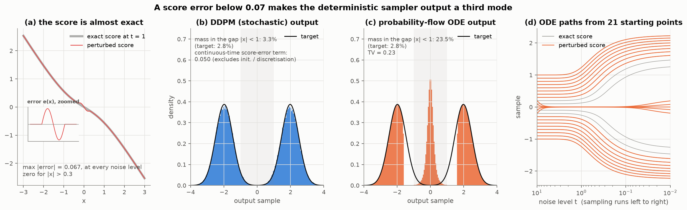
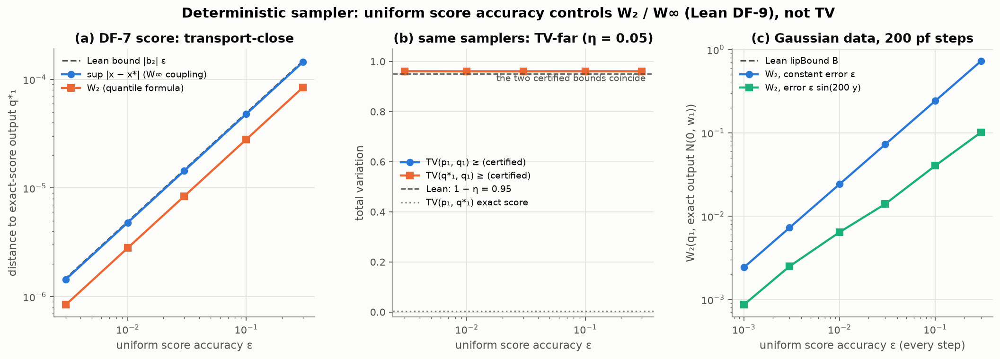
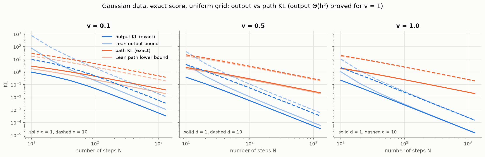
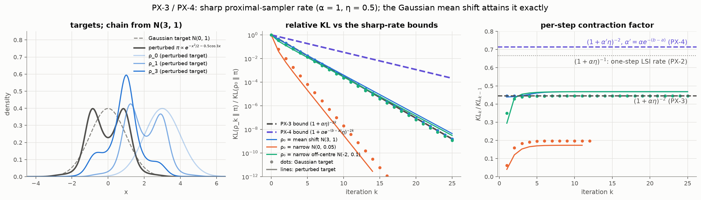

# FormalizeSampling

**When does a sampling algorithm actually sample what you think it does?**

FormalizeSampling is a machine-checked framework, in Lean 4 and Mathlib, for answering that
question: it relates the law an algorithm produces to the target law it is meant to sample, and
tracks where the gap comes from — discretisation, score estimation, kernel approximation, the
initial distribution, deterministic versus stochastic dynamics. It covers Langevin and
Fokker–Planck dynamics, the proximal sampler, Metropolis–Hastings, Gaussian-increment chains
(ULA / Euler–Maruyama), deterministic transport (probability flow, preconditioned functional
gradient flow, deterministic steps, the SVGD objective) and DDPM/DDIM-type diffusion models, with
both guarantees and counterexamples.

Every core statement names the divergence and its direction, the law under which an error is
averaged, the quantifier and the object certified. About 91,000 lines of Lean, 3,800 documented
theorems and 53 core results: 42 Verified, 8 formal counterexamples, 3 Conditional.

- Full results by area: [`docs/results.md`](docs/results.md)
- Status, hypotheses and Lean names of every core result:
  [`docs/theorem_registry.md`](docs/theorem_registry.md)
- Statement audit: [`docs/statement_audit.md`](docs/statement_audit.md)
- Specification: [`docs/blueprint.md`](docs/blueprint.md); every documented theorem:
  [`docs/declaration_index.md`](docs/declaration_index.md); vocabulary:
  [`docs/glossary.md`](docs/glossary.md)

To use the framework in your own analysis, start with [Using FormalizeSampling](#using-formalizesampling):

- **Change a drift estimator:** [GI-2](FormalizeSampling/Samplers/RandomScoreOracleKernel.lean)
  propagates conditional Monte Carlo bias and variance to output error.
- **Approximate an inner sampler:**
  [inner-to-outer error bounds](FormalizeSampling/Samplers/RandomScoreOracleInner.lean) connect
  inner KL or coupling guarantees to outer-chain error, under explicit moment assumptions.
- **Analyze your own algorithm:** import [Core](FormalizeSampling/Core.lean) or individual
  modules for divergence bounds, flows, score identities and kernel error propagation.

## How the library is organised

Sampling algorithms in the literature look heterogeneous, but their analyses reuse a few moves.
A guarantee typically bounds the divergence between output and target by the contracted initial
error plus the sum of per-step errors. Each discretisation error is computed by differentiating
along a curve and each score error from a representation of the score; comparisons of laws link
the pieces, identifying the law pins down the exact chain or curve, and exact computations show
that a step is tight or necessary.

| Move | What it provides | Main modules | Registry IDs |
|---|---|---|---|
| Comparison of laws | Pinsker and the two TV normalisations, KL chain rule and data processing, tensorisation, Gaussian KL, lower semicontinuity, extension from warm starts to every start with finite KL | [`Foundations/Pinsker`](FormalizeSampling/Foundations/Pinsker.lean), [`Foundations/KLChainRule`](FormalizeSampling/Foundations/KLChainRule.lean), [`Foundations/KLWarmApprox`](FormalizeSampling/Foundations/KLWarmApprox.lean), [`Foundations/GaussianKL`](FormalizeSampling/Foundations/GaussianKL.lean) | KL-1 … KL-4 |
| Error accumulation | compare the algorithm's chain with an exact chain step by step: initial mismatch plus summed discretisation and oracle errors, by TV telescoping, by the KL chain rule and one Pinsker step, or by couplings | [`Kernels/ErrorPropagationKL`](FormalizeSampling/Kernels/ErrorPropagationKL.lean), [`Kernels/ErrorDecomposition`](FormalizeSampling/Kernels/ErrorDecomposition.lean), [`Samplers/GaussianIncrementPi`](FormalizeSampling/Samplers/GaussianIncrementPi.lean), [`Samplers/DiffusionMain`](FormalizeSampling/Samplers/DiffusionMain.lean), [`Samplers/DiffusionPath`](FormalizeSampling/Samplers/DiffusionPath.lean) | KR-1, GI-1, GI-2, DF-1, DF-2, DF-4, DF-5, DF-9 |
| Contraction | the exact kernel or flow brings every admissible law closer to the target: log-Sobolev inequalities (Gaussian, Gross, tensorisation, Holley–Stroock, Bakry–Émery), LSI plus heat flow gives a KL contraction, couplings and shifted composition | [`Foundations/BakryEmeryGeneralPi`](FormalizeSampling/Foundations/BakryEmeryGeneralPi.lean), [`Foundations/HolleyStroock`](FormalizeSampling/Foundations/HolleyStroock.lean), [`Samplers/ProximalGeneralLSIPi`](FormalizeSampling/Samplers/ProximalGeneralLSIPi.lean), [`Samplers/RGOCouplingWeak`](FormalizeSampling/Samplers/RGOCouplingWeak.lean), [`Flow/OULangevinDecayPi`](FormalizeSampling/Flow/OULangevinDecayPi.lean) | KL-5, KL-6, PX-2 … PX-6, CE-07 |
| Differentiation along a curve | $`\frac{d}{dt} \mathrm{KL}`$ along a continuity equation, Fisher dissipation, approximate velocities, Grönwall with a source, de Bruijn along the forward and backward heat flows, one-step descent for $`\mathrm{id} + \eta v`$ | [`Identities/KLTransportVariation`](FormalizeSampling/Identities/KLTransportVariation.lean), [`Flow/KLDissipation`](FormalizeSampling/Flow/KLDissipation.lean), [`Flow/ApproximateVelocity`](FormalizeSampling/Flow/ApproximateVelocity.lean), [`Flow/DeterministicStepPi`](FormalizeSampling/Flow/DeterministicStepPi.lean), [`Foundations/HeatFlowDeBruijnPi`](FormalizeSampling/Foundations/HeatFlowDeBruijnPi.lean) | FL-1 … FL-4, DT-1, CE-08 |
| Identification of the law | a kernel, curve or particle system has the law the analysis assumes: Bayes reverse kernels (the RGO among them), Metropolis–Hastings invariance, weak Fokker–Planck and continuity equations (existence, uniqueness, DiPerna–Lions) without SDE theory, equal one-time marginals | [`Kernels/ReverseKernel`](FormalizeSampling/Kernels/ReverseKernel.lean), [`Samplers/ProximalPi`](FormalizeSampling/Samplers/ProximalPi.lean), [`Samplers/MetropolisHastings`](FormalizeSampling/Samplers/MetropolisHastings.lean), [`Flow/FokkerPlanckUniqueness`](FormalizeSampling/Flow/FokkerPlanckUniqueness.lean), [`Flow/NoiseScoreEquivalence`](FormalizeSampling/Flow/NoiseScoreEquivalence.lean) | KR-2, PX-1, MH-1, ID-3, ID-4, FL-5, FL-6, PT-1, CE-01 |
| Score representation and estimation | the score as a posterior mean (Tweedie, OU posterior) or as the minimiser of a Stein/Hyvärinen objective (feature classes, SVGD); Monte Carlo and inner-sampler errors; what a score cannot be | [`Identities/Tweedie`](FormalizeSampling/Identities/Tweedie.lean), [`Identities/OUPosteriorScore`](FormalizeSampling/Identities/OUPosteriorScore.lean), [`ScoreEstimation/SteinObjective`](FormalizeSampling/ScoreEstimation/SteinObjective.lean), [`ScoreEstimation/FeatureClass`](FormalizeSampling/ScoreEstimation/FeatureClass.lean), [`ScoreEstimation/MonteCarlo`](FormalizeSampling/ScoreEstimation/MonteCarlo.lean) | ID-1, ID-2, SE-1 … SE-4, CE-02, CE-04, CE-05, CE-06 |
| Exact computation | Gaussian closed forms and explicit constructions that attain a bound, bound it from below, or separate two samplers | [`Examples/GaussianIncrementTight`](FormalizeSampling/Examples/GaussianIncrementTight.lean), [`Samplers/ProximalSharpPi`](FormalizeSampling/Samplers/ProximalSharpPi.lean), [`Samplers/DiffusionGaussianOutput`](FormalizeSampling/Samplers/DiffusionGaussianOutput.lean), [`Samplers/DiffusionODESeparation`](FormalizeSampling/Samplers/DiffusionODESeparation.lean), [`Counterexamples/ULADiscretization`](FormalizeSampling/Counterexamples/ULADiscretization.lean) | EX-1, EX-2, EX-3, DF-3, DF-6, DF-7, DF-8, CE-03 |

Each registry ID appears once, under its primary move; most results use several moves, and the
[literature map](docs/literature.md) decomposes published analyses into them step by step. The three
Conditional rows sit at unproved inputs to the moves: PX-2 and FL-4 assume a log-Sobolev inequality
(the input of contraction), and FL-5 assumes a weak Fokker–Planck equation and uniqueness for a
continuity equation (identification of the law). Lean namespaces do not always follow file names
(for example `Foundations/KLChainRule` declares `KL.*`); the [declaration
index](docs/declaration_index.md) gives the file of every theorem. The statements keep these
distinctions visible:

- **KL direction fixes the averaging law.** Per-step errors are averaged under the chain in the
  first KL argument (KL-2): GI-1 and GI-2 average under the algorithm's laws, DF-1 and DF-5 put
  the data first and average score errors under the true marginals, and KR-1 names the averaging
  law in TV.
- **One Pinsker step, not telescoped TV.** The KL chain rule followed by one Pinsker step (GI-1)
  has no $`\sqrt{n}`$ loss; on an example where its bound is attained, summed one-step TV bounds
  overshoot the true TV by a factor of at least $`\sqrt{2n/\pi}`$ (EX-3).
- **Contraction along the chain, not uniform contraction.** Contraction along a chain's laws does
  not give a uniform TV contraction (CE-07); PX-2, PX-4 and PX-6 contract KL from every start with
  finite KL, and the stable size of a deterministic step depends on the current law (DT-1, CE-08).
- **One-time marginals, not path laws.** Equal one-time marginals do not give equal two-time laws
  (CE-01, EX-1); for DDPM on standard Gaussian data with the exact score the output KL is
  $`\Theta(h^2)`$ while the path KL is of order at least $`h`$ (DF-5, DF-8).
- **Which score accuracy suffices.** $`L^2(p_k)`$ accuracy suffices for DDPM (DF-1); uniform
  accuracy does not give TV accuracy for deterministic samplers (DF-3, DF-7) but controls a
  coupling distance to the exact-score output (DF-9).

## Main results

Each item says what is proved here in Lean and which earlier work it formalises or extends.

Notation for the diffusion results: the data is noised by an Ornstein–Uhlenbeck process, observed at
times $`0 = t_0 \lt t_1 \lt \ldots \lt t_N = T`$, with $`\alpha_k = e^{-(t_k - t_{k-1})}`$ and
$`\beta_k = 1 - \alpha_k^2`$; $`p_\delta`$ is the data law noised up to the early-stopping time
$`\delta = t_1`$. The stochastic sampler (DDPM) starts from $`\mathcal{N}(0, I)`$ and steps
$`x \mapsto \mathcal{N}((x + \beta_k \hat{s}_k(x))/\alpha_k, \sigma_k^2 I)`$ for
$`k = N, \ldots, 2`$, with a learned score $`\hat{s}_k`$; a deterministic sampler (probability-flow
ODE / DDIM) instead steps $`x \mapsto A_k(x) + b_k \hat{s}_k(x)`$, with no noise.

**1. For deterministic samplers, a uniformly small score error does not give a small total-variation output error.**
Diffusion-model guarantees are usually stated in terms of score accuracy. For the stochastic sampler
(DDPM) that is enough, given fine enough steps and a long enough run; for deterministic samplers
(probability-flow ODE / DDIM, widely used for fast sampling) it is not. This is known:
[Li–Wei–Chen–Chi (2023, §3.2)](https://arxiv.org/abs/2306.09251) perturb the last step of a
deterministic sampler by a rounding error, small in $`L^2`$, that puts the output at total-variation
distance 1 from Gaussian data, and [Li–Di–Gu (2024, Thm 3.1)](https://arxiv.org/abs/2410.14237) give
a smooth score within $`\varepsilon`$ of the true score everywhere for which the continuous-time
probability-flow ODE stays at total-variation distance at least $`1/(4\pi)`$ from Gaussian data.
Lean proves the following version. For every data law with finite second moment, there are learned
scores within $`\varepsilon`$ of the true score everywhere for which the deterministic sampler ends
at total-variation distance $`\ge 1 - \eta`$ from $`p_\delta`$, while DDPM with the same score and
reverse variance $`\sigma_k^2 = \beta_k/\alpha_k^2`$ keeps its end-to-end KL guarantee (DF-1). The
error can even be an analytic function of the exact update, placed at the last step ($`k = 2`$). We
have not found an analytic error with total-variation distance arbitrarily close to 1, for every
data law with finite second moment, stated before; the price is a large Lipschitz constant. Lean
proves a lower bound $`(2^m - 1)/\lvert b_2 \rvert`$ on it, where $`m`$ is the number of iterations
of $`u \mapsto u - \sin(2\pi u)/(2\pi)`$ in the construction, chosen non-explicitly; its growth as
$`\eta \to 0`$ is observed only numerically. For this error the failure is one of concentration, not
displacement: under an explicit coupling the deterministic output stays within
$`\lvert b_2 \rvert \cdot \varepsilon`$ of the exact-score deterministic output (a
$`W_\infty`$/$`W_2`$ bound), so it moves mass to almost the same places but concentrates it on a
thin set. Here uniform score accuracy controls the transport distance to the exact-score output, but
not the total-variation distance to $`p_\delta`$. Li–Wei–Chen–Chi already suggest a Wasserstein
metric for their example; DF-9 states the pairing as a theorem.

An error present throughout the run can also move mass where the exact flow is unstable, as between
two modes. That injected noise contracts the divergence between two runs while a deterministic flow
keeps it fixed is proved by [Nie et al. (2024, Thms 3.1–3.2)](https://arxiv.org/abs/2311.01410), and
[Ashiq et al. (2026)](https://arxiv.org/abs/2605.06831) analyse the region between two modes of a
Gaussian mixture: late in sampling, deterministic trajectories near the midpoint stay there while
DDPM's noise lets them escape, and a score error with the right directional structure can make the
equilibrium near the midpoint instantaneously stable. The first figure is a one-dimensional
numerical instance: the data has two modes, the score error is below 0.07, has Lipschitz constant
0.7 and is nonzero only near the midpoint, and the deterministic sampler puts 23% of its output
between the modes, where the data has 3%; DDPM with the same score does not.
*DF-3, DF-7, DF-9 (Verified). The figures are numerical; the construction in the first is not
formalised.*





**2. With $`\sigma^2 = \beta/\alpha^2`$, the full true-path KL cannot beat $`1/N`$;
the output can.**
Many guarantees for DDPM-type samplers, including DF-1 below and the bound of
[Benton–De Bortoli–Doucet–Deligiannidis (2024)](https://arxiv.org/abs/2308.03686) whose rate it
matches, compare the sampler with the true reverse process: they bound the sum of per-step errors
against the exact reverse kernels, or the KL divergence between the path law of the reversed forward
process and that of the sampler. That this route stops at order $`1/N`$ is known: Benton et al.
(2024, §4) note that the path KL is of the order of the step size in the worst case, for instance
for point-mass data, citing [Chen et al. (2023, Thm 7)](https://arxiv.org/abs/2209.11215), who prove
such a lower bound for the critically damped Langevin sampler on standard Gaussian data with the
exact score, and [Li–Yan (2024, §3.1)](https://arxiv.org/abs/2409.18959) make the same point for
this sampler. Lean proves it as a theorem about the DDPM chain itself. With reverse variance
$`\sigma^2 = \beta/\alpha^2`$ and data with second moment $`M = \mathbb{E} \Vert X \Vert^2 \le d`$
(e.g. data in $`[-1, 1]^d`$), both are bounded below by order $`d/N`$ on a uniform grid over a fixed
interval $`0 \lt t_1 \lt T`$: the per-step sum for the exact score, the path KL for any score.
[Sun–Poor–Zhang (2026, Thm 3)](https://arxiv.org/abs/2601.13602) give an asymptotic, continuous-time
lower bound for the exact score in which Gaussian data is the extremal case; we have not found a
non-asymptotic bound for every such data law and every score stated before. The output itself can
converge faster. For standard Gaussian data $`\mathcal{N}(0, I)`$ the exact-score output KL on the
same grids is $`\Theta(d/N^2)`$, with matching-order upper and lower bounds, while the path KL stays
of order at least $`d/N`$; [Jiao–Zhou–Li (2025, Thm 2)](https://arxiv.org/abs/2510.27562) prove an
output lower bound of the same order for $`\mathcal{N}(0, \lambda I)`$ data with $`\lambda \ge 2`$
on their schedule. A bound of order $`1/N^2`$ on the output cannot follow by upper-bounding this
full true-path KL and applying data processing alone. Jiao–Zhou–Li reach output rates of order
$`1/N^2`$ (up to logarithmic factors) for general data by applying the chain rule along an auxiliary
reverse chain that has the same marginals as the forward process but different transitions, a device
used earlier by [Li–Cai (2024)](https://arxiv.org/abs/2410.23285) for an accelerated sampler. For
every data law with finite second moment, the per-step sum is bounded below by order $`1/N`$ per
unit of log-time, minus a term that depends on $`M`$ and does not shrink as $`N`$ grows; over long
horizons this matches the order of the end-to-end bound. For $`\mathcal{N}(0, vI)`$ data with
$`v \ne 1`$ the output bounds keep an explicit initialisation term; the
[results catalogue](docs/results.md) gives them.
*DF-1, DF-4, DF-5, DF-6, DF-8 (Verified).*



**3. The proximal sampler's rates, end to end.**
For the proximal sampler of Lee–Shen–Tian (2021), the KL rates of
[Chen–Chewi–Salim–Wibisono (2022)](https://arxiv.org/abs/2202.06386) are proved with every
hypothesis discharged for strongly log-concave and log-concave targets. For $`\alpha`$-strongly
log-concave targets,

```math
\mathrm{KL}(\rho_k \Vert \pi) \le \frac{\mathrm{KL}(\rho_0 \Vert \pi)}{(1+\alpha\eta)^{2k}}
```

for every start with finite KL, with no further hypothesis: this is their Theorem 3, with the
log-Sobolev inequality proved here via Bakry–Émery. Isotropic Gaussian targets attain the rate
exactly; that the factor is sharp on Gaussian targets is observed in their §4.4 (see also
[Mitra–Wibisono, 2025, App. G.2](https://arxiv.org/abs/2410.10699)). For every log-concave target
$`\pi \propto e^{-f}`$ ($`f`$ finite and convex) in every dimension,

```math
\mathrm{KL}(\rho_k \Vert \pi) \le \frac{1}{2k\eta} \int \Vert x-y \Vert^2 \, d\gamma_0
```

for $`k \ge 1`$ and every coupling $`\gamma_0`$ of $`(\rho_0, \pi)`$, including starts with infinite
KL. Chen–Chewi–Salim–Wibisono state this rate with $`1/(k\eta)`$. The constant $`1/(2k\eta)`$ comes
from the shifted-composition argument of
[Altschuler–Chewi (2023)](https://arxiv.org/abs/2311.14520) and is stated for $`C^2`$ potentials by
[Pedrotti (2026, Cor. 3.5)](https://arxiv.org/abs/2601.13259); here it is proved for every finite
convex $`f`$, with no smoothness assumption. The strongly log-concave rate also holds for any target
with a functional log-Sobolev inequality $`\mathrm{LSI}(1/\alpha)`$ and a Gaussian upper envelope,
where the LSI is an assumption.
*PX-6, PX-3, PX-5 (Verified), EX-3 (attainment); PX-2 for general targets is Conditional on the
LSI.*



## Also proved

- **End-to-end DDPM bound (DF-1).** For every data law on $`\mathbb{R}^d`$ with finite second moment
  (no density required) and every grid with $`u_{k+1} - u_k \le \kappa u_k`$
  ($`u_k = e^{2t_k} - 1`$), the sampler with reverse variance $`\beta/\alpha^2`$ and learned score
  $`\hat{s}`$ satisfies
  $`\mathrm{KL}(p_\delta \Vert q) \le I + (\kappa d/2)(1 + \log(u_N/u_1)) + \sum_k (\beta_k/2) \, \mathbb{E}_{p_k} \Vert \hat{s}_k - \nabla \log p_k \Vert^2`$,
  where $`q`$ is its output and $`I`$ is an explicit initialisation term decaying like $`e^{-2T}`$.
  This is the $`d`$-linear rate of
  [Benton–De Bortoli–Doucet–Deligiannidis (2024)](https://arxiv.org/abs/2308.03686), proved without
  stochastic calculus (Tweedie, de Bruijn, monotonicity of Fisher information).
- **Choice of reverse variance (DF-4, DF-5).** With $`\sigma^2 = \beta`$ (one of the two choices of
  Ho, Jain and Abbeel, 2020), on grids with $`u_{k+1} \le (1+\kappa)u_k`$ up to an index $`m`$ with
  $`1 \le \kappa u_m \le 1+\kappa`$ (arbitrary afterwards), the discretisation term of the
  end-to-end bound and the exact-score path KL are bounded by constants depending only on
  $`\kappa`$, $`t_1`$, $`d`$ and $`M`$, not on $`N`$ or $`T`$. Bounds with no term growing in
  $`T`$ are known for this variance:
  [Koike (2026, Thm 3.1 and Remark 3.2)](https://arxiv.org/abs/2605.18040) for the DDPM sampler
  with $`\sigma^2 = \beta`$, obtained as the Euler–Maruyama scheme of the Föllmer process, and
  [Conforti–Durmus–Gentiloni Silveri (2023, Cor. 1)](https://arxiv.org/abs/2308.12240) for an
  exponential-integrator scheme with step variance $`\beta`$. With $`\sigma^2 = \beta/\alpha^2`$
  and $`M \le d`$, the summed per-step KL grows at least linearly in $`T`$ on a uniform grid of
  fixed step. For every positive reverse variance the exact-score per-step KL has an exact formula,
  minimised by the Analytic-DPM variance (Bao, Li, Zhu and Zhang, 2022), whose data-free upper
  bound is $`\beta/\alpha^2`$ ([Bao et al., 2022, App. D](https://arxiv.org/abs/2201.06503)).
- **Memorisation (DF-2).** With the exact score of $`n`$ training points, for every
  $`\rho, \varepsilon \gt 0`$ some early-stopping time and grid put output mass
  $`\ge 1 - \varepsilon`$ within distance $`\rho`$ of the training set. This is known for the
  continuous-time sampler ([Pidstrigach, 2022, Cor. 1](https://arxiv.org/abs/2206.01018);
  [Li–Chen–Li, 2024, Thm 4.3](https://arxiv.org/abs/2401.04856); see also
  [Gu et al., 2023](https://arxiv.org/abs/2310.02664)); here it is proved for the discretised
  sampler. It concerns the exact empirical score with vanishing terminal noise, not generalisation
  at fixed positive noise.
- **Beyond log-concavity (PX-4).** For $`\pi \propto e^{-\alpha \Vert x \Vert^2/2 - W}`$ with $`W`$
  measurable and $`a \le W \le b`$,
  $`\mathrm{KL}(\rho_k \Vert \pi) \le \mathrm{KL}(\rho_0 \Vert \pi)/(1+\alpha e^{-(b-a)}\eta)^{2k}`$
  for every start with finite KL; the log-Sobolev inequality comes from Holley–Stroock and is not
  assumed. This is Theorem 3 of Chen–Chewi–Salim–Wibisono (2022) combined with the Holley–Stroock
  perturbation lemma, with every hypothesis discharged.
- **KL, not TV, for Markov chains (GI-1, EX-3).** For Gaussian-increment chains
  $`x \mapsto \mathcal{N}(x + h_k b_k(x), 2h_k I)`$ (ULA, Euler–Maruyama) with exact drifts $`b_k`$,
  estimated drifts $`\hat{b}_k`$ and algorithm laws $`\nu_k`$,
  $`\mathrm{KL}(\nu_n \Vert \mu_n) \le \mathrm{KL}(\nu_0 \Vert \mu_0) + \sum_k (h_k/4) \int \Vert b_k - \hat{b}_k \Vert^2 \, d\nu_k`$,
  where $`\mu_k`$ are the exact chain's laws; one Pinsker inequality at the end gives TV with no
  $`\sqrt{n}`$ loss. This is the standard route of diffusion-model analyses, which sum KL errors
  step by step ([Chen–Lee–Lu, 2023](https://arxiv.org/abs/2211.01916)) or along the path
  ([Chen et al., 2023](https://arxiv.org/abs/2209.11215)) and apply Pinsker once. For a constant
  drift error and constant step from a common point mass the KL bound holds with equality, while the
  telescoped TV bound (the sum of the one-step bounds
  $`\sqrt{h} \, \Vert \Delta \Vert / (2\sqrt{\pi})`$) exceeds the true TV by a factor of at least
  $`\sqrt{2n/\pi}`$.
- **Posterior-mean scores (SE-3, SE-4, GI-2).** For every law of $`X_0`$ on $`\mathbb{R}^d`$ (no
  density or moment assumption) and $`t \gt 0`$, the Ornstein–Uhlenbeck marginal $`p_t`$ has score
  $`\nabla \log p_t(y) = (e^{-t} \, \mathbb{E}[X_0 \mid X_t = y] - y)/(1 - e^{-2t})`$, which is
  Lemma 1 of reverse diffusion Monte Carlo (rdMC;
  [Huang–Dong–Hao–Ma–Zhang, 2024](https://arxiv.org/abs/2307.02037)), stated there for targets
  with a density. When the posterior mean is re-estimated from $`N`$ fresh draws at every step, as
  in rdMC, the GI-1 bound gains a variance term of order $`1/N`$, plus the squared bias of an
  inexact inner sampler, controlled by its KL error when the exact posterior is sub-Gaussian.
- **Preconditioned functional gradient flow (SE-1, SE-2, FL-2 … FL-4, EX-2).** For PFG
  ([Dong–Wang–Lin–Zhang, 2023](https://arxiv.org/abs/2211.13954)), Lean proves their Proposition 1
  (over any class of admissible fields, the Stein objective and the $`H`$-weighted $`L^2(\rho)`$
  distance to $`H^{-1} \nabla \log(\pi/\rho)`$ have the same minimisers), finite-feature SVGD as a
  regularised minimiser (their §3.2.1), the KL dissipation identity for the exact velocity, their
  discrete Gaussian analysis (App. A.6) in 1D, and their Theorem 1 (exponential KL decay) with
  their constants, *Conditional* on their [A3] (approximation) and [A4] (log-Sobolev), with the
  flow and its regularity as hypotheses.
- **Functional inequalities (KL-1, KL-5, KL-6).** Pinsker, the Gaussian log-Sobolev inequality
  (along the heat flow from any law with finite second moment), Gross's inequality,
  tensorisation, Holley–Stroock, Prékopa–Leindler, and Bakry–Émery on $`\mathbb{R}^d`$
  ($`f - \alpha \Vert x \Vert^2/2`$ convex $`\Rightarrow \mathrm{LSI}(1/\alpha)`$).
- **Fokker–Planck well-posedness (FL-6, FL-5).** For $`D \gt 0`$ and a drift continuous in $`(t, x)`$
  and Lipschitz in $`x`$ uniformly on each $`[0, T]`$ (unbounded allowed), probability solutions
  with the same initial law coincide, with no moment or density assumption, and such drifts are
  well-posed; for autonomous Lipschitz drifts every solution is the weak limit of Euler–Maruyama
  laws. Uniqueness for these drifts is classical: it is covered by the theorem for drifts with
  $`\langle b(t, x), x \rangle \le C + C \Vert x \Vert^2`$ in Bogachev–Krylov–Röckner–Shaposhnikov,
  *Fokker–Planck–Kolmogorov Equations* (2015, Ch. 9); the proof here is a formal one, by an
  approximate Kolmogorov duality with no SDE theory. DiPerna–Lions uniqueness holds for autonomous
  Sobolev velocities ($`W^{1,1}_{\mathrm{loc}}`$, bounded divergence, linear growth) and bounded
  probability-density solutions.
  *FL-6 is Verified; the DiPerna–Lions results are part of FL-5, which is Conditional overall.*

Everything else, by area: [`docs/results.md`](docs/results.md).

## Literature map

Each row says which steps of a published analysis are formalised here and with which status.

| Work | Algorithm | What is formalised here | Status |
|---|---|---|---|
| [Ho–Jain–Abbeel (2020)](https://arxiv.org/abs/2006.11239); [Bao et al. (2022)](https://arxiv.org/abs/2201.06503) | DDPM; Analytic-DPM reverse variance | forward chain and sampler, per-step KL as a mean error, Tweedie mean; a version of Bao et al. Thm 1 and Cor. 2 per step, with exact excess; training, decoder, variance bounds and trajectory search not formalised | DF-1, DF-4, DF-5, DF-8 Verified |
| [Chen et al. (2023)](https://arxiv.org/abs/2209.11215); [Chen–Lee–Lu (2023)](https://arxiv.org/abs/2211.01916) | exponential-integrator and Euler–Maruyama schemes for the reverse SDE | a discrete-time chain rule in place of Girsanov, the score/discretisation split as an equality, initialisation and Pinsker steps; the Lipschitz and Hessian discretisation lemmas, $`W_2`$ and CLD not formalised | DF-1, DF-5, GI-1, KL-1 Verified |
| [Benton–De Bortoli–Doucet–Deligiannidis (2024)](https://arxiv.org/abs/2308.03686) | exponential integrator with early stopping | a version of Thm 2 for the Tweedie-mean sampler by heat-flow entropy, without stochastic localisation; path-KL lower bounds related to its §4 | DF-1, DF-5, DF-6 Verified |
| [Conforti–Durmus–Gentiloni Silveri (2023)](https://arxiv.org/abs/2308.12240); [Koike (2026)](https://arxiv.org/abs/2605.18040) | samplers with step variance $`\beta`$ | discretisation bounds independent of $`T`$ and $`N`$ by an exact per-step formula and the trace Cramér–Rao bound, without Itô calculus; Fisher decay along the heat flow; the Föllmer process and kinetic OU not formalised | DF-4, DF-5, KL-5 Verified |
| [Li–Yan (2024)](https://arxiv.org/abs/2409.18959); [Jiao–Zhou–Li (2025)](https://arxiv.org/abs/2510.27562); [Li–Cai (2024)](https://arxiv.org/abs/2410.23285); [Sun–Poor–Zhang (2026)](https://arxiv.org/abs/2601.13602) | DDPM: output KL versus path KL | path-KL lower bounds of order $`dh`$ for every mean map; Gaussian-data output KL of order $`dh^2`$; a per-step lower bound for every data law; auxiliary-chain upper bounds, schedules and Gaussian extremality not formalised | DF-5, DF-6, DF-8 Verified |
| [Li–Wei–Chen–Chi (2023)](https://arxiv.org/abs/2306.09251); [Li–Di–Gu (2024)](https://arxiv.org/abs/2410.14237) | deterministic (probability-flow, DDIM) samplers | a version of the §3.2 example, for every data law with finite second moment; a discrete-time analogue of Li–Di–Gu Thm 3.1 with an analytic one-step error; the Wasserstein remark as a coupling bound; the TV convergence bounds not formalised | DF-3, DF-7, DF-9 Verified |
| [Nie et al. (2024)](https://arxiv.org/abs/2311.01410); [Ashiq et al. (2026)](https://arxiv.org/abs/2605.06831) | SDE versus ODE runs; dynamics between two modes | special cases of Nie et al.: de Bruijn for two heat-flow runs (Thm 3.1 with zero drift), KL invariance under bijections (component of Thm 3.2); the non-strict data-processing step behind Thm 3.3 (its strict inequality and the Cycle-SDE kernels not formalised); Ashiq et al. not formalised | KL-2, KL-4 Verified; the heat-flow de Bruijn identity holds under an explicit regularity hypothesis (used in KL-5 and PX-2) |
| [Pidstrigach (2022)](https://arxiv.org/abs/2206.01018); [Li–Chen–Li (2024)](https://arxiv.org/abs/2401.04856); [Gu et al. (2023)](https://arxiv.org/abs/2310.02664) | reverse diffusion with the exact empirical score | memorisation for the discretised DDPM sampler with early stopping (a discretised, approximate version of Pidstrigach Cor. 1 and Li–Chen–Li Thm 4.3); the empirical score through Tweedie; continuous-time support results and Girsanov not formalised | DF-2, DF-1, SE-3 Verified |
| [Lee–Shen–Tian (2021)](https://arxiv.org/abs/2010.03106) | proximal sampler with the restricted Gaussian oracle (RGO) | the RGO as Bayes reverse kernel and invariance (Lemma 1); Lemma 4's one-step bound for every coupling; the case $`\mu = 0`$ of Lemma 2; RGO implementations not formalised | PX-1, PX-5 Verified; the coupling bound has no named hypothesis (listed under PX-2) |
| [Chen–Chewi–Salim–Wibisono (2022)](https://arxiv.org/abs/2202.06386); [Mitra–Wibisono (2025)](https://arxiv.org/abs/2410.10699) | proximal sampler, analysed along forward and backward heat flows | the KL part of Thm 3 of Chen–Chewi–Salim–Wibisono and the KL case of Mitra–Wibisono Thm 2; Chen–Chewi–Salim–Wibisono Thm 2 with constant $`1/(2k\eta)`$; sharpness on Gaussian targets; Rényi, $`\chi^2`$ and other $`\Phi`$-divergences not formalised | PX-2 Conditional on the LSI; PX-3 … PX-6, EX-3 Verified |
| [Altschuler–Chewi (2023)](https://arxiv.org/abs/2311.14520); [Pedrotti (2026)](https://arxiv.org/abs/2601.13259) | shifted composition | a version of Altschuler–Chewi Thm 3.2 for KL with $`L = 1`$; the special case $`\alpha = 0`$, $`L = 0`$, second law $`\pi`$ of Pedrotti Cor. 3.5, for every finite convex potential; Rényi, Harnack and defective-curvature results not formalised | PX-5 Verified |
| [Holley–Stroock (1987)](https://doi.org/10.1007/BF01011161); [Bakry–Émery (1985)](https://www.numdam.org/item/SPS_1985__19__177_0/) | log-Sobolev inequalities for the target | the bounded-perturbation lemma; strong convexity gives $`\mathrm{LSI}(1/\alpha)`$, by monotone transport in 1D and Prékopa–Leindler on `Fin d → ℝ` rather than the $`\Gamma_2`$ route | KL-6 Verified; used for PX-4, PX-6 |
| [Bogachev–Krylov–Röckner–Shaposhnikov (2015)](https://doi.org/10.1090/surv/207); [DiPerna–Lions (1989)](https://doi.org/10.1007/BF01393835) | weak Fokker–Planck and continuity equations | Fokker–Planck uniqueness and existence for Lipschitz drifts, without SDE theory; a version of DiPerna–Lions Thm II.2 for autonomous Sobolev velocities and probability densities; dissipative non-Lipschitz drifts and time-dependent velocities not formalised | FL-6 Verified; the DiPerna–Lions results have no named hypothesis (listed under FL-5, Conditional overall) |
| [Wibisono (2018)](https://arxiv.org/abs/1802.08089) | ULA; Langevin dynamics as a KL gradient flow; the forward method | the special case $`\mathcal{N}(0, 1)`$ of Example 2; the Example 4 recursion, with no fixed step a KL descent for all laws; KL decay along OU; SLA and the $`W_2`$ lemmas not formalised | CE-03, CE-08 Counterexample; FL-4 Conditional (OU decay with no named hypothesis) |
| SVGD: [Liu–Wang (2016)](https://arxiv.org/abs/1608.04471); PFG: [Dong–Wang–Lin–Zhang (2023)](https://arxiv.org/abs/2211.13954) | deterministic transport by a regularised functional gradient; particle updates | PFG Prop. 1, the KL dissipation identity, Thm 1 with its constants ([A3], [A4] as hypotheses), App. A.6 in 1D; SVGD with finite feature kernels (Liu–Wang Eqs. (6), (8)) as a case of PFG; PFG Prop. 2 and RKHS theory not formalised | SE-1, SE-2, FL-1 … FL-3, DT-1, PT-1, EX-2 Verified; FL-4 Conditional |
| rdMC: [Huang–Dong–Hao–Ma–Zhang (2024)](https://arxiv.org/abs/2307.02037); RS-DMC: [Huang–Zou–Dong–Ma–Zhang (2024)](https://arxiv.org/abs/2401.06325) | reverse diffusion with Monte Carlo posterior-mean scores from an inner sampler | the OU posterior score (rdMC Lemma 1, RS-DMC Lemma 2.1); Monte Carlo score error and inner-sampler bias, propagated by the KL chain rule; a discrete-time KL split of the output; inner ULA and the recursive estimator not formalised | SE-3, SE-4, GI-2, DF-1, DF-5 Verified |
| SPS: [Huang–Zou–Dong–Ma–Zhang (2024)](https://arxiv.org/abs/2405.16734); RTK: [Huang–Zou–Dong–Zhang–Ma–Zhang (2024)](https://arxiv.org/abs/2405.16387) | outer chain of exact Bayes kernels (reverse transition kernel; restricted Gaussian oracle) sampled by inner MCMC | reverse kernels and invariance; per-step inner KL errors summed by the chain rule, then one Pinsker step (RTK Lemma 3.2, SPS Lemma B.5); the exact proximal rate under an LSI; invariance of MALA; mixing of the inner MALA, ULD and SGLD not formalised | KR-2, PX-1, KL-1, KL-2, MH-1 Verified; PX-2 Conditional |

Step-by-step decomposition of each work into these moves:
[`docs/literature.md`](docs/literature.md).

## What "Verified" means

- **Proof.** Every proof is checked by the Lean kernel. The library contains no `sorry` and no
  axioms beyond `propext`, `Classical.choice` and `Quot.sound`; `scripts/AxiomAudit.lean`
  checks every declaration and fails on any other axiom.
- **Hypotheses.** A *Verified* result has only satisfiable regularity or modelling
  hypotheses. When a theorem relies on unproved mathematics (a log-Sobolev inequality, PDE
  uniqueness for a general drift), that ingredient is a named `Prop` in its statement and the
  result is marked *Conditional*.
- **Non-vacuity.** For every registry row, a module in `FormalizeSampling/Audit/` applies the
  theorem to a concrete non-degenerate instance and discharges all of its hypotheses inside
  Lean, so no headline theorem holds only because its assumptions are contradictory.
- **Encoding.** Statements are checked for encoding pitfalls, such as real-valued `KL.toReal`
  hiding an infinite divergence, or an error averaged under the wrong law.
- **Fidelity.** Each statement is compared with the literature and documented with its scope.
  This last step is a human reading, not a kernel guarantee.

Details: [`docs/statement_audit.md`](docs/statement_audit.md).

## Coverage at a glance

| Area | Registry rows | Status |
|---|---|---|
| Diffusion models (DDPM/DDIM, memorisation, variance, path vs output) | DF-1 … DF-9 | 9 Verified |
| Proximal sampler | PX-1 … PX-6 | 5 Verified, 1 Conditional |
| KL toolkit and log-Sobolev inequalities | KL-1 … KL-6 | 6 Verified |
| Flows, Fokker–Planck, continuity equation | FL-1 … FL-6, DT-1 | 5 Verified, 2 Conditional |
| Gaussian-increment chains (ULA / Euler–Maruyama) | GI-1, GI-2 | 2 Verified |
| Identities, score estimation, kernels, MH, particles | ID, SE, KR, MH, PT | 12 Verified |
| Exact examples (tightness) | EX-1 … EX-3 | 3 Verified |
| Counterexamples | CE-01 … CE-08 | 8 Counterexample |

Open directions are listed at the end of [`docs/results.md`](docs/results.md).

## Layout

| Directory | Contents |
|---|---|
| `FormalizeSampling.lean`, `FormalizeSampling/Core.lean` | entry points: the first imports the whole library, the second the sampler-independent core (`Foundations`, `Identities`, `Kernels`, `Flow`, `ScoreEstimation`) |
| `FormalizeSampling/Foundations/` | vector calculus and scores, TV, KL tools, Gaussian KL formulas, Gibbs measures, heat kernels, de Bruijn identity and Gaussian log-Sobolev inequality along the heat flow, log-Sobolev inequalities, Bakry–Émery, Prékopa–Leindler, weak derivatives, the bridge to Mathlib's `EuclideanSpace ℝ (Fin d)` |
| `FormalizeSampling/Identities/` | Stein, Tweedie, weak generator |
| `FormalizeSampling/Flow/` | continuity and Fokker–Planck equations (existence, uniqueness), reverse-time rewriting, KL dissipation and decay, OU flows, deterministic steps |
| `FormalizeSampling/ScoreEstimation/` | Stein/Hyvärinen objective, feature classes, Monte Carlo posterior means |
| `FormalizeSampling/Kernels/` | TV error propagation (per-step errors in TV or KL) and decomposition for inexact kernels, reverse kernels, Gaussian and OU kernels |
| `FormalizeSampling/Samplers/` | Gaussian-increment chains, MH/MALA, proximal sampler (heat-flow and backward analysis; also on `EuclideanSpace ℝ (Fin d)`), diffusion models (DDPM/DDIM), particles |
| `FormalizeSampling/Examples/` | closed-form Gaussian instances and tightness examples |
| `FormalizeSampling/Counterexamples/` | refutations of tempting general claims |
| `FormalizeSampling/Audit/` | statement audit: Lean witnesses on non-degenerate instances for every registry row |
| `scripts/` | axiom audit (`AxiomAudit.lean`) and contract checker (`check_contracts.py`) |
| `experiments/`, `tests/` | exact-arithmetic and numerical illustrations (never proofs) and their tests |
| `showcase/` | numpy/matplotlib experiments with figures for the headline results ([`showcase/README.md`](showcase/README.md)); illustrations, not proofs, not run in CI; most assert numerically the Lean inequality they illustrate |
| `docs/` | blueprint, theorem registry, declaration index, glossary, statement audit |

The directories are layered: a module imports only modules of its own or a lower layer, in the
order `Foundations` < `Identities`, `Kernels` < `Flow`, `ScoreEstimation` < `Samplers` <
`Examples`, `Counterexamples` < `Audit` (checked by `scripts/check_contracts.py`).
`FormalizeSampling/Core.lean` imports every module of `Foundations`, `Identities`, `Kernels`,
`Flow` and `ScoreEstimation` (the three lowest layers), the sampler-independent core;
`FormalizeSampling.lean` imports everything. Every file is a Lean module, so both modules
(`public import FormalizeSampling.Core`) and ordinary Lean files can import the library.

Files whose names end in `Pi` work on `Fin d → ℝ`. Most have a one-dimensional counterpart
without the suffix (for example `Samplers/Proximal.lean` for `Samplers/ProximalPi.lean`), which
is a separate proof on `ℝ`, not the `Pi` form at $`d = 1`$. The suffix is not exhaustive: many files
without it, such as the flow and diffusion developments, are also stated on `Fin d → ℝ`.

`Foundations/Euclidean.lean` identifies `Fin d → ℝ` with Mathlib's `EuclideanSpace ℝ (Fin d)`
(Lebesgue measure, distances, inner products, Gaussians, Gibbs measures, KL, `tvSup`, gradients
and Laplacians correspond), and `Samplers/EuclideanTransfer.lean` restates Bakry–Émery, the
invariance of the target under the proximal sampler (PX-1) and the strongly log-concave
proximal-sampler rate (PX-6) there.

## Building and checking

The project pins Lean `v4.35.0` and Mathlib `v4.35.0` (`lean-toolchain`,
`lake-manifest.json`).

```bash
export PATH=$HOME/.elan/bin:$PATH
lake exe cache get                      # download prebuilt Mathlib
lake build                              # build the whole library
lake build FormalizeSampling.Core       # or only the sampler-independent core
lake env lean scripts/AxiomAudit.lean   # axiom audit + resolve every registry and index name
python3 scripts/check_contracts.py      # modules, exports, layering, docstrings, forbidden constructs, registry
python3 -m unittest discover -s tests -v
uvx ruff@0.16.10 check scripts experiments tests showcase  # ruff pinned in requirements-dev.txt
uvx ruff@0.16.10 format --check scripts experiments tests showcase
```

CI (`.github/workflows/lean.yml`) runs the same checks, installing `ruff` from
`requirements-dev.txt`; it is started manually from the repository's Actions tab.

## Using FormalizeSampling

To depend on the library from another Lake project, add it to that project's `lakefile.toml`,
pinned to a commit:

```toml
[[require]]
name = "formalize-sampling"
git = "https://github.com/hendrydong/FormalizeSampling"
rev = "<commit hash>"
```

or, in a `lakefile.lean`,

```lean
require «formalize-sampling» from git
  "https://github.com/hendrydong/FormalizeSampling" @ "<commit hash>"
```

The project must use Lean `v4.35.0` (`leanprover/lean4:v4.35.0` in its `lean-toolchain`). The
library brings Mathlib `v4.35.0`; a project that also requires Mathlib directly must pin the
same version (`rev = "v4.35.0"`). Then run

```bash
lake update formalize-sampling   # record the library and Mathlib in lake-manifest.json
lake exe cache get               # download prebuilt Mathlib
lake build                       # the first build compiles the imported FormalizeSampling modules
```

`import FormalizeSampling.Core` gives the sampler-independent core (`Foundations`, `Identities`,
`Kernels`, `Flow`, `ScoreEstimation`), `import FormalizeSampling` everything, and single modules
such as `FormalizeSampling.Kernels.ErrorPropagationKL` can be imported on their own. The library
is written in the Lean module system, so both ordinary Lean files and modules (`module`, then
`public import FormalizeSampling.Core`) can import it. Every documented theorem is listed by
fully qualified name, with the opening of its docstring and its source line, in
[`docs/declaration_index.md`](docs/declaration_index.md).

Total variation is `FormalizeSampling.TotalVariation.tvSup`,
$`\sup_A \lvert \mu(A) - \nu(A) \rvert`$ over measurable sets $`A`$, at most $`1`$ for probability
measures. Mathlib's `MeasureTheory.tvDist` is the $`L^1`$ distance, twice `tvSup` for probability
measures (`TotalVariation.measureTheory_tvDist_eq_two_mul`; Pinsker in that normalisation is
`Pinsker.measureTheory_tvDist_le_sqrt_two_mul_klDiv`); the names do not clash when both
namespaces are open. Results on `Fin d → ℝ` transfer to Mathlib's `EuclideanSpace ℝ (Fin d)`
through `FormalizeSampling.Foundations.Euclidean`, which is part of the core (see
[Layout](#layout)).

For example, on any measurable space:

```lean
import FormalizeSampling.Core

open MeasureTheory ProbabilityTheory InformationTheory FormalizeSampling TotalVariation

variable {α : Type*} [MeasurableSpace α]

-- Pinsker, with `tvSup μ ν = sup_A |μ(A) - ν(A)|`; Mathlib's `tvDist` is `2 * tvSup`
example {μ ν : Measure α} [IsProbabilityMeasure μ] [IsProbabilityMeasure ν] (h : klDiv μ ν ≠ ⊤) :
    tvSup μ ν ≤ √((klDiv μ ν).toReal / 2) ∧ tvDist μ ν = 2 * tvSup μ ν :=
  ⟨Pinsker.tvSup_le_sqrt_klDiv h, measureTheory_tvDist_eq_two_mul μ ν⟩

-- Two Markov chains from the same start, with kernels `c`-close in KL at every state,
-- stay within `n √(c / 2)` in total variation after `n` steps
example {κ η : ℕ → Kernel α α} [∀ n, IsMarkovKernel (κ n)] [∀ n, IsMarkovKernel (η n)]
    {μ ν : ℕ → Measure α} [IsProbabilityMeasure (μ 0)] (h0 : ν 0 = μ 0)
    (hμ : ∀ n, μ (n + 1) = κ n ∘ₘ μ n) (hν : ∀ n, ν (n + 1) = η n ∘ₘ ν n) {c : ℝ}
    (h : ∀ n x, klDiv (κ n x) (η n x) ≤ ENNReal.ofReal c) (n : ℕ) :
    tvSup (μ n) (ν n) ≤ n * √(c / 2) := by
  have : IsProbabilityMeasure (ν 0) := h0 ▸ inferInstance
  simpa [h0, tvSup_self] using
    ErrorPropagation.tvSup_chain_le_sum_sqrt_klDiv hμ hν (c := fun _ => c) h n
```

On a countably generated state space (including `ℝ` and `Fin d → ℝ`), the following
version accumulates KL before applying Pinsker once. With a common initial law and a
per-step budget `c`, it gives `√(n * c / 2)`. Notice the KL direction and averaging law:
the error is `KL(approximate kernel ‖ exact kernel)`, averaged under the approximate chain.

```lean
import FormalizeSampling.Kernels.ErrorPropagationKL

open MeasureTheory ProbabilityTheory InformationTheory FormalizeSampling TotalVariation

variable {α : Type*} [MeasurableSpace α]
  [MeasurableSpace.CountableOrCountablyGenerated α α]

example {κ η : ℕ → Kernel α α} [∀ n, IsMarkovKernel (κ n)] [∀ n, IsMarkovKernel (η n)]
    {μ ν : ℕ → Measure α} [IsProbabilityMeasure (μ 0)] (h0 : ν 0 = μ 0)
    (hμ : ∀ n, μ (n + 1) = κ n ∘ₘ μ n) (hν : ∀ n, ν (n + 1) = η n ∘ₘ ν n)
    {c : ℝ} (hc : 0 ≤ c)
    (h : ∀ n, ∫⁻ x, klDiv (η n x) (κ n x) ∂(ν n) ≤ ENNReal.ofReal c) (n : ℕ) :
    tvSup (ν n) (μ n) ≤ √((n : ℝ) * c / 2) := by
  have : IsProbabilityMeasure (ν 0) := h0 ▸ inferInstance
  have hKL0 : klDiv (ν 0) (μ 0) ≠ ⊤ := by simp [h0]
  simpa [h0] using ErrorPropagation.tvSup_chain_le_sqrt_klDiv_add_sum
    hμ hν hKL0 (c := fun _ => c) (fun _ => hc) h n
```

## Statuses

- `Verified`: proved in Lean; the hypotheses are explicit regularity or modelling assumptions
  that are satisfiable and do not encode the main mathematical step.
- `Conditional`: proved in Lean from a named hypothesis that packages unproved mathematics
  (PDE uniqueness, Fokker–Planck for an SDE, a log-Sobolev inequality, an oracle error bound).
  Such hypotheses are ordinary `Prop` arguments or definitions, never axioms.
- `Counterexample`: a Lean-verified refutation of a tempting claim.
- `Planned`: statement and assumptions written down, not yet proved.
- `Open`: research question without a fixed statement.

## Contributing

Conventions and rules for new results: [`CONTRIBUTING.md`](CONTRIBUTING.md).

## License

Apache License 2.0; see [`LICENSE`](LICENSE).

## Citation

If you use this library, please cite it as:

```bibtex
@misc{dong2026formalizesampling,
  title        = {{FormalizeSampling}},
  author       = {Dong, Hanze},
  year         = {2026},
  howpublished = {\url{https://github.com/hendrydong/FormalizeSampling}},
  note         = {Lean 4 / Mathlib library}
}
```
